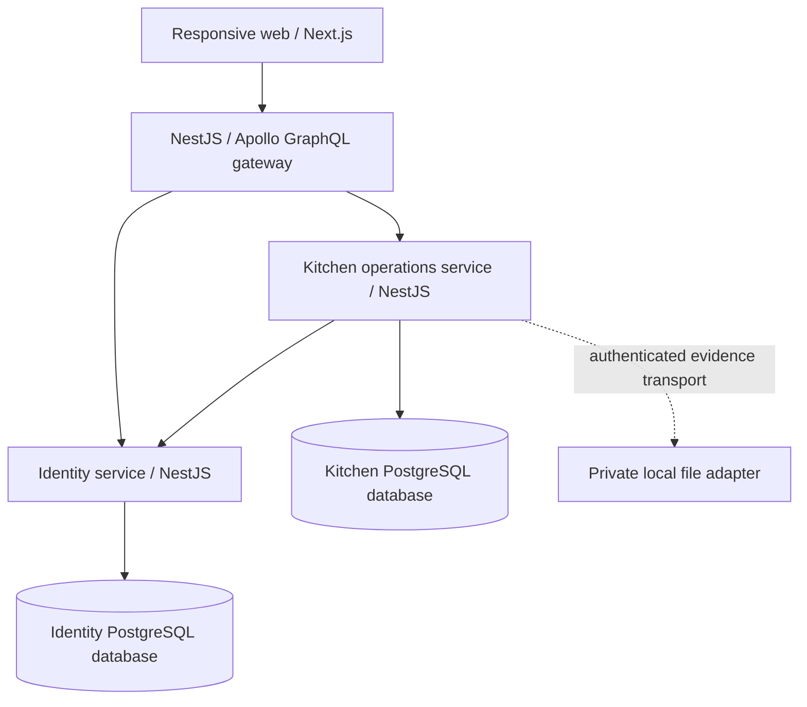

# First-slice architecture

Date: 2026-11-04 (Europe/Paris). Delivery package: **SP1-01**.

These engineering decisions select the local synthetic implementation baseline. They are not restaurant approval, a live-provider selection or evidence of implemented software. Product authority remains [specification v0.80](../../plans/APPTIT_SPEC_v0.80_EN.md), especially §§10, 13–14 and RF-01, and the original backlog. Historic code is not a compatibility constraint.

## Decision index

| ADR | Decision | Status / scope |
| --- | --- | --- |
| [0001](adr/0001-topology-and-workspace.md) | Capability-grouped microservices, Nx/npm, responsive web | Selected for first slice |
| [0002](adr/0002-data-and-transactions.md) | PostgreSQL authority, Prisma isolation, atomic ledger and outbox | Selected; persistence implemented later |
| [0003](adr/0003-identity-and-offline.md) | Opaque revocable sessions, site capabilities, isolated draft ownership | Selected online contract; offline capture disabled initially |
| [0004](adr/0004-adapters-evidence-and-recovery.md) | Explicit adapter modes, private evidence, provisional retention and recovery | Local choices selected; live integrations remain gated |

The [wire and domain contracts](contracts/first-slice.md) and [dependency-free TypeScript definitions](contracts/first-slice.ts) express the same baseline. They are design artifacts, not runtime validators or an application package. [SP1-01 evidence and handoff](../delivery/SP1-01.md) maps acceptance and remaining work.

## Boundaries

Services communicate through authenticated internal HTTP/JSON contracts. Domain code imports neither GraphQL nor Prisma nor provider SDKs. Gateway composes responses and owns no business database. Operational records always carry tenant and site. Lunch/cafeteria are contexts within a site, not duplicate physical inventories.

[SP1-03 runtime value and persistence contracts](contracts/quantity-draft.md) document the implemented primitive/reference-draft slice.

## Implementation sequence

1. SP1-02: initialize workspace/apps and exact compatible dependency versions; record a toolchain matrix and lockfile; add local PostgreSQL and CI.
2. SP1-03: runtime quantity/date validation, versioned persistence, schema migrations and attributable changes.
3. SP1-04/05: sessions, scoped fixture memberships, private product query and visible UI.
4. Sprint 2: draft receipt/evidence/control adapters. Sprint 3: effectful ledger, operation registry, concurrency and outbox where needed.

No ADR here marks its parent AP item Done. No application, broker, database, cloud account or provider is activated by these documents.
