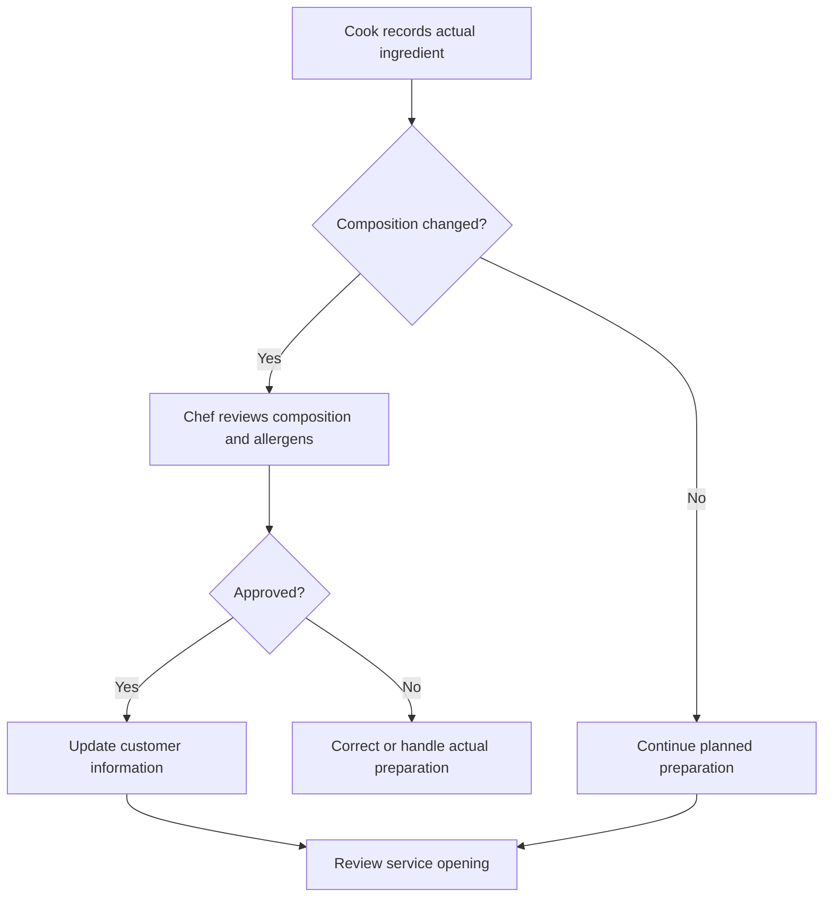

# Apptit — Product and Build Specification

**Version:** 0.80 · **Source date:** 4 November 2026 · **Product owner:** Rodrigo Paiva  
**Language:** English working edition of `APPTIT_SPEC_v0.1.md`, internal version 0.80.  
**Status:** MVP functional foundation consolidated; initial wireframe proposal documented. Pilot authorization, real operational data, local food safety procedures, budget and technical decisions remain pending.

This edition preserves the source's section numbering, requirement identifiers, decision identifiers, food safety use cases and workflow identifiers. Repeated historical explanations are consolidated into their governing requirements and cross-references. It is an English editorial edition, rather than a sentence-by-sentence translation. No additional feature approval, implementation, legal verification or pilot authorization is implied. French regulatory terms and proposed French application labels are retained where useful.

## 1. Mandate for this restart

Restart Apptit's specification from the business and the operational experience. Existing code, schedules and previous technical decisions do not impose compatibility requirements. Earlier materials are evidence and references, rather than automatically binding requirements.

The document consolidates the business understanding and establishes a verifiable initial specification. It is neither a portfolio presentation nor an implementation report. It assumes no delivered features, signed customers, contracts, partnerships, successful tests or demonstrated results.

Use these distinctions throughout:

- **Founder's direction / confirmed decision:** explicitly attributed to Rodrigo in the current instructions or visible conversation; remains authoritative unless superseded.
- **Documentary reference:** content found in an examined document, potentially containing old assumptions or AI-generated proposals.
- **Proposal:** a recommendation for this specification. Interaction details, acceptance criteria and wireframes remain proposals unless explicitly approved.
- **To be determined:** missing information that affects scope, operation, accountability or technical design.

Later explicit founder decisions prevail over older proposals. Sections 7 and 23 define the current MVP boundary. Describing a rule or screen does not demonstrate its implementation.

## 2. Analysis coverage and limitations

The source specification reviewed available text from the Business Plan, Business Model, Business Model Canvas, user research, an earlier sales presentation, interview preparation for Didier, a document named Branding, infrastructure and feature planning, authentication checklists, QQOQCCP/PPCO matrices, associated academic materials, and original architecture/HACCP documents. Identified Apptit Drive folders were explored to the documents and technical references listed in section 20.

NOVYU's strategic foundation was also examined to understand a possible integration. Its personal and legal information is not needed for Apptit's product definition and is excluded.

The local directory was empty at the initial inspection. This does not establish that no code exists elsewhere; the restart does not depend on that conclusion.

Complete conversation retrieval was unavailable during the original consolidation. The foundation therefore uses visible history, its contextual summary and documents actually retrieved; it does not claim to cover every conversation in the account. A draw.io diagram and five TSX files were identified but not audited: text extraction was empty and local transfer failed. The architecture PDF, containing earlier conversation and interface examples, was read as a reference.

Earlier claims of implementation, expert validation, pilots or partnerships are treated as narratives, not evidence of those events. Empty academic or administrative forms establish no product decisions. This English edition translates the existing specification's research record; it does not repeat that research or certify current law.

## 3. The business being built

**Apptit is a B2 B SaaS platform connecting kitchen planning, execution and replenishment to help foodservice operators reduce waste, control costs and maintain food safety evidence.**

The broader ambition is an intelligent operating system for institutional catering: connect kitchens, managers and suppliers, progressively extending to logistics and financial processes. Value depends on operational continuity, reliable data and ease of use.

Rodrigo's foodservice experience helps identify hypotheses and access real operations. It does not replace user observation, buying validation or measurement of outcomes.

### 3.1 Problems addressed

| Problem | Operational consequence | Expected response |
| --- | --- | --- |
| Fragmented stock, purchasing and records | Repeated entry and incomplete decisions | Connect records by product, batch, site, service and supplier |
| Poor expiry visibility | Losses, unnecessary purchases and unsafe use risk | Batch tracking, alerts, rotation and restrictions |
| Planning disconnected from consumption | Overproduction or meal shortages | Connect attendance, recipes, production, sales and leftovers |
| Fragmented purchasing | Difficult comparison and delivery checks | Calculated needs and, later, approval/order/receipt continuity |
| Burdensome food safety recording | Missing follow-up and evidence | Short routines, owners, deviations and corrective actions |
| Limited multi-site visibility | Difficult comparison and intervention | Scoped indicators with common definitions |
| Excessive administrative effort | Less time for production | Fast capture, imports, reuse and task-oriented screens |

### 3.2 Available user evidence

The user interview response sheet contains six visible responses from April and October 2025, all from corporate catering establishments. Three report 101–500 meals/day and three report over 500. Five answered yes to beta testing and one answered maybe. This expresses historical interest, not a current commercial commitment.

All six prefer a simple, minimal interface; some also want detail and charts. Four report spending 2–5 hours/week on stock and orders, one less than two hours, and one 5–10 hours. Themes include use-by dates, rotation, allergens, costs, attendance forecasting and team communication. One explicitly links computer time to production disruption; another asks for access by role.

These are useful signals for corporate kitchens and operational UX. A small, concentrated sample does not validate the whole market, pricing, financial returns, or suitability for hospitals and schools.

### 3.3 Value by participant

| Participant | Required ability | Value to demonstrate |
| --- | --- | --- |
| Chef and kitchen team | Plan and execute with reliable information | Less rework and better ingredient use |
| Storekeeper / receiving operator | Check and move goods quickly | Fewer discrepancies and retrievable traceability |
| Site manager | Monitor budget, losses and routines | Intervene before problems grow |
| Regional management | Compare sites and performance | Consistent visibility and justified decisions |
| Quality / HACCP lead | Review records, deviations and corrections | Complete, accessible, contextual evidence |
| Purchasing / finance | Approve needs and resolve differences | Fewer inappropriate purchases and better reconciliation |
| Supplier | Receive clear orders | Recurrence, fewer ambiguities and follow-up |
| Diner | Understand what is offered | Clear menus and approved information |

## 4. Segments and market entry

Institutional catering is the core market: corporate restaurants, schools, universities, hospitals, clinics, EHPAD and central kitchens. Traditional restaurants appear in earlier documents and the NOVYU discussion, but require separate validation.

**Confirmed:** Rodrigo has access to a corporate restaurant that could authorize use. Authorization has not yet been obtained. The pilot is designed for this type of establishment. Its location, operator and participants remain to be confirmed; Île-de-France is an earlier reference, not a confirmed pilot location.

### 4.0 Initial pilot qualification

| Topic | Founder-provided information | Consequence |
| --- | --- | --- |
| Access | Potential permission at a corporate restaurant | Identify the decision-maker and obtain authorization |
| Main problems | Menu creation/display, expiring products, allergens, HACCP, inventory and rotation | Connect planning and execution with traceable stock |
| Current tools | Excel; screens fed by a spreadsheet described as a “sheet” | Examine the actual format and display connection; do not assume Google Sheets |
| Infrared | Data described as received through “infrarouge” | Identify transmitter, receiver and content; do not reinterpret as Wi-Fi or a specific API |
| Existing player | Connected box, unknown brand | No compatibility, replacement or purchase assumed |
| Recipe files | Latest clarification: generic ingredients, quantities and yield only; standard Excel template | Do not assume imported allergens, nutrition or cooking instructions |
| Desired capacity | Available ingredients should indicate feasible portions, including shared use | Deterministic calculation and joint allocation |
| Inventory | No systematic control | Opening inventory and a simple capture routine are necessary |
| Receiving | Storekeeper scans, consults OFF, records quantity and checks conditions | Product/batch receipt with actual delivery observations |
| Suppliers | No participating supplier contacts yet | Pilot must work without an integrated marketplace |

Expiring products are a reported problem, without measured frequency, quantities, causes or specific products. Do not attribute losses to missing alerts before observing operations.

**Current operational qualifications:**

- Approximately 400 lunches/day, Monday–Friday. This is a declared average for sizing, not a fixed demand forecast or imported historical count.
- A cafeteria sells drinks and ready-made products. No food preparation was reported there; this does not establish that every drink is packaged. Beverage preparation, quantities and stock/sales coverage remain to be examined.
- Breakfast and dinner are not included by inference. Opening times, holidays and exceptional closures are unknown. Closed days are not zero demand for an offered dish.
- A combination of on-site preparation and central-kitchen supply may be possible. This is a scenario to support and qualify, not confirmation that the pilot already operates that way.
- Identify each preparation as produced locally, received ready-made, or received for finishing. Preserve origin, receipt, batch and actual local processing. A received preparation does not consume fictitious local raw ingredients; only real additions/transformation do.
- Lunch and cafeteria are identifiable contexts in the same site; they must not duplicate shared physical stock, such as milk. Lunch portion forecasting is not automatically applicable to drinks or retail articles.

Hospital, EHPAD, school and central/satellite operations have distinct requirements. Individual clinical diets, school menus and inter-kitchen distribution must not be inferred from a generic corporate workflow. Traditional catering may reuse stock, recipes and safety capabilities, but its à-la-carte use, pricing and margins need validation.

Earlier open questions about raw/cooked ingredients, weekly planning and opening weekdays have been answered by later decisions. Remaining fieldwork concerns actual files, procedures, instruments, display connection, authorizations and operating responsibilities.

### 4.1 Buyer, user and data authority

These are different roles. In outsourced catering, the building owner, corporate customer, catering company and physical restaurant can be different organizations.

**Proposal:** a tenant represents the contracting organization responsible for operations; a site represents an operational unit. A corporate customer may receive authorized reports without owning access to the whole tenant. Data ownership, export rights and transfer when operators change require contractual decisions before the pilot.

## 5. Business model

Earlier documents converge on SaaS subscriptions plus supplier transaction revenue, complemented by modules and services. The marketplace is a long-term economic ambition, but is explicitly deferred from the MVP.

| Revenue stream | Proposed role | Preconditions |
| --- | --- | --- |
| SaaS per site/plan | Recurring operational use | Standalone value without connected suppliers |
| Marketplace commission | Monetize purchases actually intermediated | Supplier terms, attribution, returns and billing defined |
| Advanced AI/analytics | Additional decision value | Usable data and measurable benefit |
| IoT | Equipment supervision | Hardware, installation, support and reliability |
| Onboarding/migration/training | Enable adoption | Defined service scope and delivery cost |
| API/enterprise integrations | Support complex operations | Demonstrated demand and support capacity |
| Logistics/financial processes | Extend the ecosystem | Explicit responsibilities and operational role |
| Screens/NOVYU | Possible extension | Separate validated offering and contracts |

Historical references include Starter €199, Professional €499 and 1.5–3% commissions in the Business Plan, versus an illustrative 5% in the Canvas. These are not an approved price list. Historical free-entry ideas do not establish an approved freemium model.

Pricing requires onboarding, support, infrastructure, AI, transaction costs and willingness-to-pay evidence. GMV is not Apptit revenue. ARR/customer/revenue-mix simulations are not demonstrated targets.

## 6. Final experience and operating cycle

This section describes the broader product vision. Purchasing, logistics and finance elements do not override the MVP exclusions in sections 7 and 23.

### 6.1 Before service

The manager selects site and meal service. The chef enters expected attendance, reviews eligible stock and priority batches, chooses recipes and builds the menu. Calculations use explicit quantities, units and yields. AI proposals state their context and limitations. Authorized people approve the plan and, in the future purchasing scope, purchases.

### 6.2 Replenishment and receiving

In the full vision, orders are sent and tracked through confirmation, preparation, dispatch and delivery where supported. The team checks quantities, batches, dates, temperatures and condition. Partial acceptance, quarantine and rejection are distinct; only accepted/released quantities become usable.

### 6.3 Production and service

The team follows tasks and safety controls, confirms actual ingredient batches and declared production. Approved menu information is published. Ingredient changes require composition/allergen review before updated information is used for service.

### 6.4 Closing and learning

Record production, sales/known service quantities, leftovers, disposal and causes. Connect them to inventory and service without treating every consumption or unexplained difference as waste. Forecasts use historical coverage and data quality explicitly.

### 6.5 Financial evolution

Associate documents with orders and receipts; reconcile ordered, received and invoiced quantities/prices. Payment is separate. Accepted physical inventory must not wait for invoice receipt or payment.

## 7. Complete vision and initial scope

The MVP helps teams plan and execute with less effort, supported by traceable stock and assisted forecasting. Waste reduction is an economic pilot outcome. This does not approve every interaction detail or future feature.

### 7.1 Priority MVP journey

1. Select a representative set of complete recipes, all their ingredients and selected cafeteria products; import recipes and count opening stock. Mark coverage boundaries.
2. Receive products through barcode/OFF, label and batch/date checks, actual quantity and applicable controls. Problem quantities await the chef's decision and remain unavailable.
3. Plan the week using experience, company information and available history. AI dish suggestions consult stock. The chef accepts, changes or rejects; deterministic capacity respects shared ingredients.
4. Review and publish: chef validates composition/product information/allergens before service. Sending and confirming display are separate states. Physical player integration remains deferred.
5. Execute: record production, actual products/batches and applicable evidence/controls. A bag transfer is not total consumption. Adaptations require review and updated information before serving.
6. Close: relate declared production, Innovorder CSV/Excel sales, leftovers and destinations. Preserve estimated/measured distinctions; do not equate differences with waste or deduct ingredients again at sale.
7. Count and learn: chef or storekeeper confirms adjustments following targeted physical checks. Measure effort, adoption, inventory reliability, forecast usefulness and losses within explicit coverage.

The pilot uses phones/tablets, with personal and shared devices and known weak-signal areas. Section 13 limits offline behavior.

### 7.2 Current capability allocation

| Capability | MVP boundary | Limitation / evolution |
| --- | --- | --- |
| Access | Individual identity, site permissions, authorship; director substitutes for absent chef | Authentication/session method open; SSO not a dependency |
| Products/receiving | Barcode, OFF, label/document fallback, batch quantities and deviations | OFF not assumed complete; no supplier integration required |
| Inventory | Representative opening inventory, locations, transfers, expiry, theoretical consumption and targeted checks | Estimated balance is not physical measurement |
| Recipes/menu | Net raw quantities, gross/net weights, yields, allergens, estimated nutrition, weekly planning, shared capacity and shortages | Real import mapping and product equivalence still require examples |
| Intelligence | Thematic dish discovery, stock-aware suggestions, assisted forecasting and portion/composition guidance | Methods evaluated against data; no autonomous production/publication |
| Communication | Approved menu and dish information, including reviewed allergens | Player/printer deferred; advertising later |
| Execution/safety | Production, batches/labels, adaptations, applicable routines, deviations, leftovers and labels | 32-case catalogue is profile/PMS-dependent, not 32 universal mandatory forms |
| Closing/sales | Innovorder CSV/Excel import and reviewed dish mapping | Automatic API later; sales do not deduct raw ingredients again |
| Evaluation | Effort, use, stock quality, forecasting and losses | Targets and pilot duration open |
| Purchasing | Missing-ingredient list and receiving purchases made through existing channels | Orders and marketplace later |

Invoices, payments, supplier commercial comparison, full logistics, IoT, advanced OCR and advanced BI are not first-test dependencies. Assisted label capture belongs to the approved receiving direction, but no extraction tool/model has been selected. Food safety coverage follows actual activities and the PMS, not arbitrary commercial exclusions.

## 8. Initial functional requirements

### RF-01 — Organizations and permissions

Every operation validates identity, tenant, site and capability on the server. Users may have explicit memberships in several organizations/sites. Historical ADMIN, CHEF, STOCK and DIR labels do not automatically cover quality, purchasing, finance or suppliers. Platform administration and customer administration differ.

**Confirmed authorities:**

- Cooks and the sous-chef can write recipe drafts; the chef validates them.
- The chef approves and publishes menus directly, without mandatory third-party approval.
- The chef decides the destination of problematic received goods.
- The chef and storekeeper can confirm stock corrections; no dual signature was required.
- The chef and another explicitly designated responsible person can authorize eligible reuse; they need not jointly sign. The second person's identity is still unknown.
- The restaurant director may perform the chef's approvals during the chef's absence, using the director's own identity. This is scoped substitution, not platform administration or cross-site access. Activation/ending mechanics remain a design detail.

**Product permissions:** the chef can grant or deny a specific cook permission to withdraw/use specific products in a site. Product use rights are distinct from catalogue viewing, recipe compatibility, batch eligibility, safety release and menu publishing. Grant, revoke and use events are separately audited and revalidated on confirmation.

**Bulk authorization from an assigned recipe:** the chef selects cook and recipe/version/assignment and chooses “Release recipe products.” Proposed confirmation: “Release to [cook] only the products linked to recipe [name — version]?” Buttons: “Yes, release” / “No, cancel.” Show recipient, recipe version and identifiable product set, with an inspectable list; do not demand repetitive manual line-by-line grants. Cancel/close grants nothing and does not revoke earlier rights.

The grant covers exactly the reviewed commercial products mapped to that recipe for that cook/site/context. Generic ingredient names do not grant every similar product. Unmapped/ambiguous ingredients remain pending before claiming complete release. Later recipe/product additions require review of the difference; they do not silently enlarge existing grants. Earlier permissions from other grants are not silently revoked. Grant duration/revocation policy remains to be detailed.

Audit the real granting person, site, recipient, recipe/version/assignment, exact set and time, including later changes. Server confirmation is required; retries must not duplicate grants. If the set changes while the modal is open, review it again. Do not hide a partial grant. Product release does not move inventory, select actual used batches, release quarantine, validate unknown allergens or publish a menu.

**Acceptance:** changing IDs cannot expose another tenant's records, attachments, reports or searches; revoked access prevents new operations; material administrative actions are audited.

### RF-02 — Catalogue and enrichment

**Confirmed:** barcode lookup in Open Food Facts is the principal receiving path. Manual entry is an exception, not mandatory full-product registration before every receipt.

Separate generic ingredient reference, commercial product/presentation, supplier offer and received batch. A barcode identifies a product reference/presentation, not its delivered batch, date or quantity. Bulk goods must be registrable without GTIN. Preserve codes as text.

External/OCR values keep source, date and review state. Missing allergen information is unknown, not allergen-free. External updates must not overwrite reviewed fields or historical approvals silently.

**Acceptance:** unknown products can be entered manually; external lookup failure does not itself block recording a receipt; packaging/conversion is explicit; unverified data is visible. Necessary food safety data still governs usable-stock release.

#### RF-02.1 — OFF product information and site-owned observations

Retrieve available identity, name, brand, images, nominal pack size, ingredients, declared allergens, traces, nutrition, categories, labels and metadata. Handle missing products, incomplete responses, network failure and schema changes separately; lookup failure is not proof of absence.

| Reference information, if available in OFF | Delivery/site authority |
| --- | --- |
| Barcode, name, brand, image | Site, location, operator and time |
| Nominal packaging quantity | Actual received/accepted quantity and checked conversion |
| Ingredients, allergens, traces, nutrition | Physical label review, actual batch and actual date |
| Categories and labels | Applicable observed temperatures, condition, decisions and evidence |

Even an external date field does not prove the delivered batch's expiry. OFF inclusion does not prove delivery compliance. Declared presence and traces remain distinct; OFF cannot establish local cross-contamination conditions.

**Proposal:** backend adapter, structured operational fields and source snapshots/references with freshness/version and applicable licensing. Keep routine checks short with optional detail. Cache/rate-limit/retry policies are implementation decisions; do not fix obsolete API versions or limits. Reuse an appropriate reviewed local record when offline/unavailable, or enter label-based data with evidence and pending fields. Do not send private stock information to OFF or publish contributions merely by receiving goods.

### RF-03 — Batches and movements

Track site, storage location, product, batch where applicable, quantity, unit, date/time and reason. Distinguish physical, reserved, available, blocked and in-transit states where those flows exist. FEFO and FIFO are not synonyms.

**Confirmed rotation behavior:** suggest the available, released, eligible batch with the nearest applicable use deadline for the preparation date. The cook checks the package and confirms the actual batch or chooses another. This is deterministic rotation, not an AI requirement, and does not itself identify physical goods, reserve or consume them.

Show batch/location/available quantity, balance quality, deadline and explanation. Consider validated post-opening/preparation deadlines. Exclude quarantined, blocked, empty and ineligible batches. Unknown dates require checking, not fictitious priority. Allow multiple batches where required; preserve each link and whether quantities are estimated. A product/brand change is not merely a batch switch. Revalidate before shared confirmation; cached suggestions are dated. Use a documented stable tie-breaker without inventing a safety difference.

Confirmed movements are corrected through traceable adjustments/reversals, not deletion. Initial prevention of consumption beyond recorded availability requires an explicit exception policy for physical discrepancies; never hide a deficit by clamping to zero.

**Acceptance:** concurrent withdrawals cannot consume the same availability; retry does not duplicate a movement; blocked stock does not increase production capacity; physical checks generate attributable adjustments.

#### RF-03.1 — Opening inventory and pilot capture

There is no systematic current inventory. The storekeeper is associated with receipts and cooks with use/withdrawals, but the existing recording medium and timing were not established.

**Confirmed startup scope:** selected complete recipes with every ingredient plus selected cafeteria products. Exact recipes/products and counts remain to be selected; no number is approved. Count the relevant stock across locations/batches, capturing observation time, operator, quantity, unit and quality. Create opening-inventory movements, not fictional historical deliveries. Unknown batch/date/origin remain unknown with eligibility handled explicitly.

The later production decisions refine the earlier capture options: use declared production and the versioned recipe for theoretical consumption, with operator correction/exceptions and targeted reconciliation. A plan is not production; confirming portions does not prove ingredients were weighed. Known losses, returns and unrecorded uses need their own records. A previously consuming withdrawal and production association must never deduct twice; transfer/reservation is separate from consumption.

Show last physical check, pending records and known adjustments. Unknown stock is not zero. Show recorded-stock capacity separately from physically checked availability. Coverage outside the pilot subset is explicit, including shared use in other dishes or the cafeteria.

#### RF-03.2 — Whole package moved to the kitchen

**Confirmed:** the cook takes the whole bag to the kitchen and its remainder stays there. No specific bag weight was confirmed. Kitchen stock is a persistent location, not automatically consumed or returned at each service.

**Proposal:** reserve-to-kitchen movement is an internal transfer. Example only: transfer a 5 kg bag; reserve −5 kg, kitchen +5 kg, site total unchanged. Consume 2 kg; total becomes 3 kg. Return those 3 kg; only location changes.

Preserve product/batch/date/source/unit. Barcode alone does not identify which batch/bag. Internal package identification may be evaluated; it does not require a selected printer. Opened pack nominal weight is not its remaining content. Record opening and applicable validated conditions/deadline without a universal rule. No fictitious end-of-day return is required. Existing allocations follow the same stock and are not duplicated after transfer. Kitchen location alone does not establish availability or consumption.

Consumption may be theoretical/corrected/measured according to its recorded basis. Distinguish loss, internal return and other use. Retry cannot duplicate transfer. Scanning an opened bag must never restore full nominal weight.

#### RF-03.3 — Estimated consumption and reconciliation

**Confirmed:** ingredients are dosed by eye; cooks can declare portions produced, approximately where necessary. Do not require weighing at every withdrawal or promise exact real-time physical inventory.

**Proposal:** at completion of each preparation, show dish, service, recipe version, planned quantity and declared production. Compute theoretical use, allow correction and identify the basis: recipe-derived, operator-estimated or measured. A confirmation does not upgrade an estimate into a measurement. Drafting or prefilling from a plan does not establish production.

Additional batches have their own records; correction posts a traceable difference rather than repeating full consumption. Example: 5 kg recorded, 80 g/portion, 30 declared portions → 2.4 kg theoretical use and 2.6 kg calculated remainder. A later observed 2.2 kg generates a −0.4 kg adjustment with known reason or “cause not identified.” Do not automatically label it waste, theft or someone's fault.

Label capacity “estimated from recorded inventory” when underlying balances are estimated, and show the last check. The example indicates about 32 calculated portions, not guaranteed physical availability. Offer a targeted check near a critical limit; do not invent a blanket safety percentage.

Reconcile the same movement history, accounting for corrections, concurrency and observations after/before movements. Do not double-consume at reconciliation, sale or additional-batch entry. Negative-stock/discrepancy policy remains to be resolved explicitly; deficits and uncertainty must remain visible.

#### RF-03.4 — Assisted targeted physical checks

**Approved:** the system prioritizes checks, a person observes stock, and an authorized person confirms the adjustment. AI cannot observe physical stock or turn theoretical use into measurement. Opening inventory remains necessary; no fixed check frequency was approved.

Explain priorities using divergence history, age of last count, opened packs, estimated balance, shortage impact and inconsistencies. Explainable rules can start the queue; additional models require evaluation. Do not fabricate calibrated confidence scores or waste entries from anomalies.

Capture product/location/batch, observed amount/unit, count/weigh/estimate method, observer/time, comparable difference and reason. A visually assessed quantity remains estimated. Do not silently distribute an unbatched total across batches with different dates.

**Authorized confirmers:** chef or storekeeper for their site. Observer and confirmer are separately recorded, even when identical. No mandatory two-person approval or amount limit was established. Approval posts one traceable adjustment; rejection preserves the observation without changing balance.

Offline observations remain pending and must reconcile against movements since their observation time. Conflicts need review, not blind overwrite. Define frequency, list size and coverage during the pilot; checking flagged products does not prove accuracy of all others. Track effort and discrepancy quality. Out-of-scope stock is unknown, not zero, and partial calculations are never presented as restaurant-wide completeness.

#### RF-03.5 — Scanned withdrawal with per-cook product authorization

Authenticated operator opens a withdrawal/use task, linked to preparation where relevant, and scans the commercial product. Check three independent conditions:

1. Cook/product/site/context permission.
2. Reviewed recipe-ingredient compatibility, or a change requiring review.
3. Actual batch/quantity eligibility and availability.

One successful check never substitutes for the others. Bulk recipe grants under RF-01 avoid repeated manual grants for already included products. A general withdrawal without recipe does not approve that product for every future dish.

Show permitted, awaiting authorization, unknown product, unidentified/ineligible batch, conflict or insufficient balance. A denied cook can request chef authorization, with context. A manual identification exception, if supported, keeps identical controls/authorship. Revalidate the decision before effect.

Scan is identification, not movement or consumption. Whole-bag movement is a transfer. Reuse withdrawal references in the production draft, but confirm actual batches at completion. Existing kitchen stock does not require a fictitious transfer. Do not scan every identical unit; enter quantity and separate batches. Repeated scanning must not silently increment quantity.

Preserve actual operator, product/batch, action, quantity where relevant, times and permission version. Revocation applies to new confirmations without erasing history. Offline cannot announce fresh shared grants/movements. If unauthorized physical use already occurred, capture the true composition and incident for review; do not erase the fact or retrospectively label it authorized. App controls do not prove physical prevention of access to the store.

### RF-04 — Recipes, menus and production

Version recipe ingredients, quantities, units, yield, portion references and approved information. A menu belongs to site/date/service; proposed states are draft, approved, published and superseded/cancelled.

**Confirmed operational rules:**

- Existing recipes use raw ingredients and a reference yield such as 10 or 100 portions. Rodrigo's correction to raw supersedes the earlier cooked/prepared answer.
- Calculation uses net usable raw weight; display both gross and net weights. Cooking yield is a separate transformation.
- Menus are planned weekly. The chef chooses any number of starters, mains and desserts, with no fixed quota. Empty categories need no fictitious item. Reordering/duplication are editable UX proposals.
- The chef estimates attendance using history, company information and experience; preserve source and adjustments.
- Production usually happens before service but additional batches may occur during lunch.
- At the end of each preparation, the cook records produced portions, counted or estimated, and confirms actual ingredient batches on the same screen, reusing receiving photos. Drafts are allowed during preparation; do not postpone required in-process controls until final confirmation.

Valid production confirmation creates theoretical ingredient consumption once using the exact recipe/composition version. Unknown batch links remain pending, not fabricated. Additional production is a separate incremental record: 80 initial +20 additional =100 produced, with only the extra 20's use posted. Correction is different from an additional batch. A new batch need not create a new recipe version if composition is unchanged. Sales never deduct these raw ingredients again. Offline capture preserves authorship/observation time without claiming shared confirmation.

**Ingredient adaptations:** cooks may make small changes but the chef validates before serving, with updated public information. “Small” has no established operational threshold and does not imply negligible allergen/quantity/yield impact. The chef approves/publishes directly; cooks cannot publish by virtue of editing.

Preserve the approved base recipe/menu. Record execution-level changes by dish/service/batch, old/new ingredient, quantities/units, actual products/batches where known, reason, author, time and whether proposed or already physically used. Review composition, allergens, capacity and consumption. A local change does not edit the standard recipe; adopting it into a new standard version is separate.

If already used, record the fact even if rejected. Rejection cannot undo physical preparation or restore ingredients. Trigger appropriate disposition and information correction. Later approval cannot retroactively prove diners were correctly informed. A proposed change not yet used leaves the approved version identified while pending.

Allergen composition includes real products, brands, sauces and seasonings. OFF is enrichment; review labels/supplier documentation as needed. Unknown/conflicting data is not absence. Separate declared presence, traces and local cross-contamination assessment. Chef approval ties exact preparation composition to customer-facing information. Relevant unresolved information requires handling before release; publication failure requires an appropriate updated-information fallback before service. Sending is not proof of display. Exact restrictions/contingency and permitted substitution criteria remain to be detailed.

Adjust only affected consumption, preserving movements/history. Different compositions in the same service remain identifiable for traceability, leftovers and labels. Concurrent edits require review; offline cannot auto-approve or publish.

**Scaling:** for raw net quantity Q_i, positive reference yield R and planned/declared portions P, net requirement = Q_i × P/R. Convert to the same stock basis, including gross conversion when needed. Missing/zero yield is not one portion. Preserve internal precision; distinguish display/purchase rounding from theoretical use. Validate proportional scaling versus whole units, fixed batches and culinary adjustments.

Example only: 8 kg/100 portions =80 g/portion; 30 portions imply 2.4 kg net in the compatible basis. Planning projects needs; declared production estimates use. Store recipe/yield/factors with each plan and production; future edits do not rewrite history.

Weekly planning aggregates shared ingredients by preparation date, eligible deadlines and commitments. Draft allocations are simulations, not consumption. Show current stock, projected use and expected receipts separately; expected goods are not received stock. Revisions preserve published history and identify affected services. Option counts and summed starters/mains/desserts do not count unique diners, nor imply equal portions per item.

#### RF-04.1 — Dish capacity and shared ingredients

Separate demand forecast, isolated capacity and the chef's joint plan. Isolated maxima using shared stock cannot be added together.

Let S_i be usable quantity for ingredient i in the authorized scope/date, excluding external reservations and ineligible/blocked stock. Let a_ij be the amount of ingredient i per portion of recipe j in a compatible stock basis, including validated transformations. No missing factor or quantity may be invented.

For proportionally scalable recipes:

- Isolated capacity for dish j = min_i floor(S_i/a_ij), over required ingredients.
- A joint plan x_j is feasible only if, for every i, Σ_j a_ij x_j ≤ S_i.
- Aggregate every occurrence of the same ingredient. Whole units, fixed batches and rounding need their own rules.

Show the limiting ingredient. Partial valid inputs can produce a clearly labelled partial bound, never full feasibility.

Example: 5,000 g usable rice, dish A 80 g/portion and B 60 g/portion. Rice-only isolated maxima are 62 A or 83 B, not both. Planning 30 A allocates 2,400 g, leaving 2,600 g and at most 43 B. Planning 44 B requires 40 g more. Another ingredient may reduce B's actual limit to 20. Portions across components are not automatically unique people.

Chef chooses priorities; do not silently optimize dish allocation. Simulation does not move stock. A confirmed reservation, if implemented, is transactional. When reopening/editing a plan, calculate from stock before its own allocations and subtract them once. Revalidate current balance/version before confirmation. Unknown raw/cooked conversion produces insufficient-information state. Changing preparation date reevaluates batch eligibility.

#### RF-04.2 — Publication compatible with the existing screen

Current spreadsheet/display platform, data authority, infrared mechanism and access permissions are unknown. Research was authorized, not hardware purchase/replacement.

**Proposal:** Apptit owns approved menu content and version; an adapter/export feeds the existing channel after compatibility and permission checks. If the spreadsheet is also manually edited, define field authority and reconciliation. Keep costs, balances, reservations and forecasts private; publish only approved dish information.

Record version, destination, attempts and channel acknowledgement where available. Spreadsheet write success does not prove TV update; without telemetry, state the verification limit and require operational checking. Handle partial updates, stale content, critical changes, withdrawal and fallback without false success.

#### RF-04.3 — Display independent of a signage platform

**Confirmed:** player choice is deferred. Yodeck was rejected due to platform/subscription dependence and equipment. No alternative device or operating system was selected. Menu display remains in the MVP; initially validate browser output without assuming restaurant hardware compatibility.

**Proposal:** Apptit fullscreen browser display on general-purpose hardware, potentially an x 86/Linux mini-PC. Reuse the existing box only if compatible/authorized. Menus/history must not depend on a particular vendor or mandatory third-party per-screen signage account/license. Hosting, energy, maintenance and support still cost money. “Apptit Display” is a working component name, not a defined commercial product.

Approve menu → publish scoped version → authorized device retrieves it → browser displays → TV receives video. Spreadsheet export can support migration but is not mandatory for the new flow, nor must infrared be reproduced.

Proposed capabilities: startup/recovery after power failure, restricted revocable device identity, no admin tokens in URLs, consistent version updates, dated last communication, cache only until approved content validity, safe expiry fallback and reconnect. Last communication is not display/audience proof. Test power cycles, clock/date, network loss, revocation and menu change; browser use alone does not guarantee offline cache.

Historical research, not current quotations or choices: on 27 October 2026 a used Dell Wyse 5070 8 GB/128 GB appeared at €89 before shipping, with €50 shipping displayed for the shown destination; HDMI may require a DisplayPort adapter. A €159.99 GMKtec G3 Plus listing was an unavailable barebone without RAM/SSD, not a complete system. Raspberry Pi kiosk options were possible, not selected. Verify power supply, connectivity, installability, recovery and total delivered cost after defining complete budget, resolution and network. Nothing was bought/tested.

#### RF-04.4 — AI dish suggestions based on inventory

**Approved:** chef requests stock-aware dish suggestions, reviews them, and may accept, adjust or reject. A search bar also supports culinary/theme queries, such as “Thai dishes,” while retaining the restaurant's own recipe library.

Consult authorized site recipes, stock and the current service/plan. Prioritize relevant own recipes; distinguish validated own recipes, drafts/AI ideas and external references. New ideas are untested proposals. External content requires an actual source and suitable license; do not invent references, claim web searches that did not happen, or claim authenticity without support. No recipe API/search/model provider is selected.

Show name/description, relevance, main ingredients/preparations, stock matches, confirmed shortages separately from unknowns, sources/timestamps, reasons and recipe status. Capacity, nutrition, allergens and loss estimates require adequate quantities/yields/mappings. Vague ideas remain inspiration, not fabricated feasible recipes. Alternative suggestions compete for the same stock; recalculate after acceptance.

An existing result opens its version without duplicate registration. A new reusable idea/reference can create a draft, identifying AI assistance separately from the human author. Complete/correct generic ingredients, actual product associations, net/gross weights, loss factors, yield, intermediate preparations and portion references, then follow chef validation. Applying to a plan, publishing and granting cook product permissions are separate actions.

Revalidate data/version before accepting once into the planning draft. No stock consumption, purchasing, autonomous substitution or production is authorized. Retained preparations must be eligible/released before reuse suggestions. A missing ingredient is a conditional alternative, not an in-stock option. Culinary relevance and general dietary guidance are considered without inferring healthiness from cuisine alone.

If AI/search fails, keep manual recipe selection. Cached authorized content remains dated; fresh external generation/lookup needs connection. Licenses also constrain translated/derived stored content. No external recipe integration is mandatory for every search. Preserve historical proposal reasons and sources without later silent rewriting.

#### RF-04.5 — Gross/net weights and preparation loss

**Approved:** show both weights; recipe calculations use net raw usable ingredient weight. The chef supplies initial reference values and can edit preparation loss percentage based on experience. Store the actual person's name with each action. Values are estimates unless measured; no weighing of every execution was required.

Let net raw usable weight be L and loss percentage of gross weight be p. Yield y =1−p/100; gross requirement B =L/y. Editing p preserves L and reference portions and recalculates B, expected difference B−L, stock requirements/capacity/shortages. Do not use L×(1+p/100). Require finite values, 0≤p<100 and positive net weight for this conversion. Missing p is not silently 0%. Imported inconsistent gross/net/percentage values require review.

Example: L=8 kg, p=20% → B=10 kg, expected difference 2 kg. At p=25%, L stays 8 kg, B≈10.667 kg, difference≈2.667 kg. For 30 of 100 portions at 20%: net 2.4 kg, gross 3 kg, expected difference 0.6 kg.

For comparable cleaning observations, y=L/B and p=(B−L)/B×100; require B>0 and 0≤L≤B. Hydration, mixing and cooking are distinct processes. Net raw is not ready/cooked mass. OFF does not automatically provide validated cleaning/cooking yields.

Scale net quantities first. Gross stock requires net/y; equivalent pre-cleaned stock uses net directly and must not incur another cleaning loss. Changing presentation may change the factor. Missing necessary conversion means incomplete calculation. Do not consume gross stock and then deduct its expected cleaning difference again.

Gross−net is expected preparation difference, not proof of discarded mass. Trimmings may be reused; distinguish discard, recovery and unknown destination. Separate expected reference losses from observed cleaning disposal and prepared leftovers. Chef validation does not make estimates measured. Reference edits generate no real waste/movement and do not alter historical production.

For comparable aggregate cleaning-loss rates use Σ differences / Σ gross weights, not an unweighted average of percentages. State units, period, sample and coverage; never combine kg, litres, units or incompatible stages without valid conversion.

Audit stable authenticated user ID plus name at the time, site, recipe/ingredient/version, action, old/new values and time. Preserve author separately from validator; renaming/deactivation/user switching must not reassign past actions. Free-text names are not proof of authorship. Keep offline observed time and server confirmation time distinct. Affected open plans recalculate; approved/history versions are not silently replaced.

#### RF-04.6 — Generic ingredients and actual products

**Confirmed:** Excel recipes use generic names, such as rice or cream, without required brands.

**Proposal:** stable ingredient reference → reviewed compatible commercial product/presentation → actual received batch. Preserve original imported wording; offer reviewed association rather than automatic homonym merging or spelling-based duplicates. Do not require nonexistent source brands to save a draft.

Verify unit, physical state, culinary characteristics and yields before pooling availability. Raw, cleaned and processed presentations are not equivalent by name. A product compatible with several generic references is still one physical stock quantity. Missing mapping/factor is incomplete coverage, not invented stock. Product/cook authorization is a separate relation, and a bulk recipe grant includes only its reviewed exact product set.

Generic names cannot establish final allergens. Use actual product information with label/document review; brand/presentation changes trigger relevant pre-service review. Candidate product differences are provisional until actual composition is established. Preserve execution links and product evidence despite future mapping/supplier changes.

Example: generic cream 1 kg → reviewed product A → batch A-01, reusing its receipt photo. Product B is a distinct candidate, not automatically compatible or released.

#### RF-04.7 — Intermediate preparations and composed recipes

**Confirmed practice:** sauces/broths are produced in quantity and shared across dishes.

**Proposal:** reusable versioned intermediate recipe, reference yield in kg/litres/units, and consuming recipes specifying the quantity needed. Raw net ingredients and cleaning factors remain explicit. Scaling uses compatible required quantity / reference yield; kg/litre conversion needs a validated factor. Ready preparation yield differs from cleaning yield. Record produced yield as measured/estimated, actual ingredient batches, author/time/version and preparation batch ID.

Producing the preparation consumes source ingredients once and creates traceable prepared stock. Incorporating existing prepared stock into a dish consumes that preparation, not its raw ingredients again. New production creates a new batch. Simulation creates neither movement.

Aggregate shared needs across dishes/services; allocate eligible existing prepared stock once, then derive raw needs only for the shortfall. Avoid simultaneously counting sauce and ingredients already used to make it. Prevent direct/indirect circular recipe dependencies at every level.

Example: 10 kg sauce M-01, dishes use 2 kg and 3 kg →5 kg remaining. If a plan needs 12 kg while 10 kg remain eligible, make only the missing 2 kg. Preserve received batches → intermediate batch → final dishes → service/destination links. Changed composition affects consuming dishes' allergen review. Incorporation/splitting/reprinting must not reset deadlines or thermal history.

Cook grants must distinguish permission to use ready sauce from permission to produce it or access every raw ingredient. Internal preparation IDs are not commercial OFF GTINs. Identification UX remains open and must respect deferred printer choice. Editing a recipe never rewrites existing batches.

#### RF-04.8 — Draft recipe creation and chef validation

**Approved:** cooks and sous-chef create/edit standard recipe drafts; chef validates. This applies to intermediate recipes too. Execution adaptations remain separate.

**Proposed states:** draft → in review → validated, or returned for correction. Keep recipe identity separate from data version. Submit exact content and differences for review; preserve original author and validator. Chef may author and validate directly without a third approver; director substitution remains applicable.

Review generic ingredients, necessary product links, net quantities/units/yield, gross references/loss percentage, intermediate versions, composition/allergens and relevant derived information. Saving a cook proposal does not replace a chef-validated reference. Missing required yield/conversion/information must remain visible and cannot produce a false complete/validated state.

Drafts may be consulted/simulated as drafts; they are not validated execution/publication references. Keep previous validated versions while new versions await review. New validation does not silently replace versions in plans, productions or grants. Show impacted plans; historical batches retain the factors/composition used. Recipe validation does not publish a menu or grant products.

Preserve author, base version, edits, times, submission and exact decision. Concurrent content changes require renewed review. Offline drafts are permitted under section 13; shared approval requires server permission/version checks. Repeated submission/confirmation does not create duplicate versions/approvals.

#### RF-04.9 — Allergens and nutritional information in recipes

**Requested:** display allergens and a nutritional table. Source files contain only ingredients, quantities and yield; cooking method is not confirmed as available or mandatory.

Allergens appear in a visible block, derived from reviewed products and intermediate preparations. Generic/planned recipes without definite products show provisional references/pending review. Separate declared allergens, traces and unknown information. Product authorization does not validate allergens. Actual executions use real products/batches and relevant chef review before service. Product/intermediate-version changes show affected consumers. OFF cannot prove absence of kitchen cross-contamination.

**Proposed nutrition fields:** energy kJ/kcal, fat, saturates, carbohydrate, sugars, protein and salt; fibre when reliable. Initially show per-reference-portion estimates derived from ingredients. Per 100 g ready dish requires compatible final mass; per 100 ml requires final volume. Portion count alone is not final mass. Cooking/hydration/draining/evaporation prevent equating raw net mass with ready mass.

Use available OFF values with label/document or reviewed local reference as needed. Do not select an arbitrary brand's values for a generic ingredient. Preserve source, product/state, basis (100 g, 100 ml or a known-size portion), units/date/version. As-sold and prepared states differ; mass/volume conversion requires justification. Missing nutrition is not zero, and partial sums are not complete totals.

For comparable 100 g data: nutrient contribution = edible net grams × nutrient per 100 g /100. Sum comparable contributions, divide by positive recipe portions for per-portion estimates, and record assumptions on cooking retention, absorption and drainage. Apply appropriate sourced/versioned process factors when available; otherwise state limitations. Do not include discarded peel mass or apply cleaning loss twice. Per 100 g ready = estimated total nutrient / final ready mass ×100.

Intermediate contributions use their composition/yield and incorporated quantity, without adding both sauce and raw sauce ingredients again. Chef-defined ready portion ×yield may supply nominal estimated final mass where coherent, but is not measured yield or a substitute for necessary raw/ready conversions.

Derived draft fields recalculate for review. External updates do not overwrite approved recipes, past production or public information. An internal nutrition table does not automatically imply customer publication or nutritional certification. Allergen safety treatment and nutrition-estimate completeness remain distinct.

Technical references examined on 4 November 2026: [OFF Product-Nutrition Schema](https://openfoodfacts.github.io/documentation/docs/Product-Opener/schemas/schemas/product_nutrition/) and [official export fields](https://github.com/openfoodfacts/openfoodfacts-server/blob/main/html/data-fields.txt). These explain data interpretation, not a certified dish-calculation method or a legal obligation to publish nutrition in this restaurant.

#### RF-04.10 — AI-assisted portion weight and component composition

**Approved:** chef defines total ready-portion grams and percentage by component, with AI recommendations for inventory use and general good dietary practices. The example 40% vegetables, 20% protein preparation, 40% starch is configurable, not a universal formula or macronutrient ratio. Because customers choose freely (RF-04.11), this is a planning/portioning reference, not a measured individual plate.

For positive finite ready-portion mass T and component percentage p_k, grams =T×p_k/100. A complete reference composition totals 100%, with documented rounding tolerance; do not silently adjust the chef's distribution. Allow appropriate components rather than mandating three groups. Represent sauces/side dishes without double-counting. A mixed-function food's mass counts once; mixed dishes require coherent reference composition/yield.

Illustration, not a dietary prescription: 500 g at 40/20/40 gives 200 g vegetables, 100 g protein preparation and 200 g starch. For 100 reference portions: 20/10/20 kg ready output. 100 g protein preparation does not mean 100 g protein nutrient.

Ready portion, net raw ingredient and gross raw product are three different bases. Scale component recipes through validated final yields, then apply cleaning loss only where the gross stock presentation requires it. Never equate 200 g cooked rice with 200 g raw rice or cleaning percentage with cooking yield. Missing factors leave partial calculations. Allocate existing eligible prepared stock once before deriving new-production needs.

Changing T/percentages recalculates projected requirements, capacity, shortages, expected preparation difference and estimated nutrition; saving a reference is not consumption/disposal. Preserve version, author, validator and old/new values; past production stays unchanged.

AI considers usable stock/deadlines, compatible presentations/yields, the joint plan and available nutritional sources. Show recommendation versus current reference, quantitative effects, reasons and limitations. Chef accepts/edits/rejects. Deterministic calculations remain outside invented model prose. Manual entry remains available when model/data/connectivity fail.

Use appropriate sourced public adult dietary recommendations and weekly variety, including relevant vegetables, pulses and wholegrain starches, rather than stock alone or weight ratios as a health verdict. Do not impose unsupported numerical targets. General guidance is not individual clinical advice or automatically transferable to children/hospitals/EHPAD; this decision adds no individual health-data collection. Safety blocks and unresolved allergens cannot be overridden to use stock.

Official references consulted on 4 November 2026: [adult recommendations](https://www.mangerbouger.fr/manger-mieux/a-tout-age-et-a-chaque-etape-de-la-vie/les-recommandations-alimentaires-pour-les-adultes) and [weekly variety](https://www.mangerbouger.fr/manger-mieux/se-faire-plaisir-en-mangeant-equilibre/manger-equilibre-ca-veut-dire-quoi-et-comment-y-arriver/comment-varier-son-alimentation-sur-la-semaine). They support general guidance, not the example's 40/20/40 formula or a validated Apptit recommendation method. Acceptance of a composition neither publishes nor expands product grants.

#### RF-04.11 — Free customer choice without individual plate recording

**Confirmed:** customers choose components; recording each choice during service is impractical. The MVP must not depend on individual plate capture. Production additions and required safety controls remain recorded.

Track offered preparations separately where operationally meaningful: rice, pasta, vegetables, protein preparation, sauce. Each has appropriate recipe/batch references, production and estimated closing leftovers. Use masses or reference portions only with valid conversion. Fixed/indivisible mixed dishes need not be split into fictitious component weighings. Planned meals are not equal servings of every side.

Raw use derives from declared production, not inferred customer combinations or sales. Shared prepared batches are not duplicated across main dishes. Traceability is to preparation/service and known batch links, not to individual consumers or plates.

Innovorder sales retain their actual granularity; named mains do not prove recorded sides. Never allocate sales automatically using 40/20/40. Aggregate apparent outflow may use comparable opening prepared stock, production additions, available amounts, remaining stock, known disposal and other destinations, explicitly estimated. Unknown differences are not automatically served or wasted. Missing inputs remain gaps; chef references can seed component forecasts, with improvement dependent on usable history. No additional sensor, till integration or tray-photo requirement is introduced.

Publish reviewed information per actual component/preparation, using reference portion or 100 g basis when justified. A suggested combined plate can display clearly labelled reference nutrition; no single total can claim to represent all customer choices or measured individual intake. Free choice does not remove pre-service updated allergen information for each offered preparation.

#### RF-04.12 — “To taste” / “quantity sufficient” ingredients

**Confirmed/approved:** existing files use qualitative quantities for ingredients such as salt, oil and seasoning. Keep the culinary wording and add a chef-defined numerical reference quantity/unit per recipe yield for estimated stock use and nutrition. No weighing at every preparation is required.

Preserve the original text on import; missing numeric reference is not zero. Drafts may be saved with visible pending fields. Without necessary quantity/unit/basis, do not claim complete consumption, capacity, shortages or nutrition. Ingredient presence and allergens remain represented even without a quantity. Product availability alone does not indicate recipe dose.

Scale reviewed references by yield/production and keep their estimated nature. AI may suggest identified values but cannot silently fill/approve missing data. Cook edits remain drafts, with authorship, chef review and versions. Past production references do not change. Missing quantity must not remove an ingredient from product grants, actual batch links or allergen assessment.

#### RF-04.13 — Standardized Excel recipe import

**Confirmed in v 0.80:** existing files follow a standard Excel template. Exact columns, sheets and units have not been examined.

**Proposal:** map that template once and reuse the mapping for compatible files. Preview recipe name, yield, generic ingredients, quantities and units. Preserve original file and source values. Import as drafts, flag missing data, ambiguous units and ingredient associations. Do not invent weights, loss factors, brands, nutrition or allergens absent from the source. Complete and validate under RF-04.8–04.12.

Incompatible structures require correction. Recognized reimports do not silently duplicate records or overwrite validated versions. A universal arbitrary-spreadsheet importer is not in the MVP. A real authorized sample is still needed to validate the mapping.

### RF-05 — Needs, orders and approval

**MVP decision:** show only a missing-ingredient list. Order creation, commercial approval and sending are deferred; purchases continue through existing channels.

Aggregate needs by ingredient/unit/site/service/period, compare against eligible availability once and show required quantity, considered stock and shortage. Include balance quality, incomplete coverage and update time. Eligible retained preparations reduce new-production needs without deducting source ingredients again. Recalculate after plan/stock changes. Safety margins/export details remain proposals; no arbitrary extra quantity is assumed. The list neither moves/reserves stock, creates an order nor contacts a supplier.

**Future scope:** purchase suggestions and sent commercial orders are separate. Respect local budgets/approval authority, confirmed inbound goods and explicitly configured margins. Sent orders preserve prices/terms/version; supplier/value changes require defined reapproval. Retry must not duplicate an order; send failure is not supplier confirmation.

### RF-06 — Delivery tracking

Preserve order-to-delivery tracking in the broader vision, not as an MVP supplier dependency. Separate commercial order, dispatch, arrival and checked receipt even in one timeline.

Every update keeps source/time: supplier, carrier, operator or integration. Real-time status, ETA and geolocation require actual supporting sources; otherwise use identified manual updates. Partial delivery keeps outstanding amounts; late events cannot regress state incorrectly. Arrival is not acceptance; delay, cancellation and rejection remain visible.

### RF-07 — Receiving checks and nonconformities

**Approved:** storekeeper records the issue; chef decides disposition of affected goods. Director substitutes when chef is absent. Stock-adjustment rights do not grant disposition/reuse authority. Keep reason, affected batch/quantity, evidence, author and time; affected goods remain unavailable while pending. No role can override applicable safety prohibitions.

Accept, reject or quarantine separately by line/batch. Accepted quantities produce movements once; returns and quarantine release are distinct operations. Example: 20 ordered, 18 delivered, 16 accepted, 2 rejected →16 usable, not 20; retain the shortage and rejection. Retry adds nothing again.

#### RF-07.1 — Main scanned receiving journey

**Confirmed:** storekeeper already measures refrigerated/frozen delivery temperature with a thermometer. Instrument, method, sampling and measurement point are unknown; this does not prove an infrared/connected/core-temperature measurement.

**Approved evidence capture:** photograph and retain the label per product/batch at receiving. Assisted extraction can propose batch/date for human review; if photo/capture/reading fails, enter actual batch/date manually. No-photo, unreadable-photo, upload-pending and extraction-failed-with-readable-photo are separate states. Manual typing does not create photographic evidence. Kitchen staff later identify actual used batches and reuse photos; additional photography is exception-only.

**Approved capture unit:** scan the product once and enter quantity for that batch. Different batches remain separate even with the same barcode. Do not scan every unit or silently increment amounts on repeated scans. Example: ten checked 5 kg bags from one batch represent 50 kg, subject to actual accepted quantity.

Proposed operational steps:

1. Open receipt in the authorized site, with operator and supplier/origin/document where available. No integrated order or marketplace supplier is required.
2. Scan or type barcode, retrieve OFF/local reference, and compare name/image/presentation to the goods. Scanning alone changes no stock.
3. Enter actual quantity, unit and checked packaging conversion, distinguishing nominal pack size from delivery quantity, including outer cases.
4. Record actual batch, date type/value and necessary label evidence. Separate distinct batches/dates.
5. Perform controls appropriate to product condition/category and local procedure: transport, integrity, dates and temperature when applicable. Do not use one “all regulations passed” button.
6. For temperatures, enter the actual observed value/unit, time and product/batch/control group, method/instrument where required, and applicable rule. Blank is not satisfactory; never prefill expected temperature as observation or require connected hardware.
7. Review accepted, rejected, quarantined and pending quantities, reasons and storage. Required pending/critical controls prevent usable release. Chef handles deviations.
8. Persist receipt, evidence and accepted stock entry consistently/idempotently; show real result and next-product action.

Keep normal capture short, reuse safe header/reference data and avoid unnecessary cold-chain delay. Proposed receipt states: draft, checks pending, confirmed/cancelled, with separate line decisions; final states/checklists require local configuration. An OFF outage is not evidence of absent allergens or a reason to bypass required safety information.

Acceptance covers matching/missing OFF product, network/persistence failure, pack conversion, separate batches, partial acceptance/rejection/quarantine, required pending fields, repeated scans/submissions, permission denial and uncertain timeout. Idempotency is per operation, not barcode alone: genuine later deliveries must still create entries.

#### RF-07.2 — Proposed receiving screens and transitions

| Step | Main data/action | Expected behavior |
| --- | --- | --- |
| Open receipt | Authorized site, source/supplier/document | Operator from session; no prerequisite integrated order |
| Identify | Barcode, name, image, presentation | Loading/error/result; physical match and typed fallback |
| Check line | Quantity/unit, batch, date type/value, storage, applicable controls | Progressive fields; separate reference data and delivery observations |
| Review | Accepted/rejected/quarantined/pending quantities and reasons | Show stock effect; no usable confirmation with necessary data missing |
| Result | Confirmed entries and unresolved amounts | Accurate usable balance and continue with next product |

Quantities in mutually exclusive decisions reconcile to the received amount. Complete accepted portions may be confirmed while the rest stays pending; show partial handling. Quarantine is not acceptance; release requires its own authorized evidence-based decision. Closing requires every quantity handled. Cancelling a draft makes no movement; correcting confirmation uses adjustment/reversal.

After timeout, retrieve the same operation's status before retry. Offline drafts never claim server acceptance/notification delivery. Reuse delivery header and product data; scan count is not units received. Stockkeeper receives within authority; chef handles problematic-goods decisions. No particular pilot operator has yet been appointed.

### RF-08 — HACCP and traceability

**Confirmed:** current safety controls are on paper. Actual forms, procedures, frequencies and coverage have not been examined.

**Proposal:** short phone/tablet forms reproduce validated routines without mandatory historical archive transcription. Start with applicable receiving, holding, cooling and reheating activities. Record equipment/preparation/batch, observed value/unit, observation time, actual operator and applicable procedure/version. Do not fill expected values or interpret missing data as compliance. Manual measured-value entry can support the pilot without sensors.

Limits/frequencies come from validated local procedures. Deviations retain original measurements and open action/review; completing a checklist does not resolve an incident. Photos support evidence where useful, not every measurement by assumption. Offline local alerts are not delivered remote notifications. Retrieval/export by date/object is scoped and includes gaps. Define paper transition, contingency and retention with the site.

Do not adopt generic 2024 HACCP numbers as universal rules. Apptit supports procedures and evidence; software alone does not ensure food safety or legal compliance.

#### RF-08.1 — Researched French regulatory foundation

The source records founder-requested research from 27 October 2026, supplemented on 29 October in section 21. Distinguish law, official guidance, the site's PMS and product/operational rules. Small-establishment guidance can be stricter than regulations and does not automatically apply to this pilot.

Core references: Regulations 178/2002,852/2004,853/2004 where applicable,2073/2005; French orders of 21 December 2009 and 8 October 2013; Regulation 1169/2011 and consumer-code R412-12–R412-16. Activity declaration/approval requirements depend on actual activities/destinations.

Receiving checks are delivery/category/risk-specific. Taking a photo of every unit is not a universal identified obligation. Temperature limits differ by category/process; +4°C is not a universal food limit. Distinguish DLC (use-by) from DDM (best-before): expired DLC cannot be treated as merely a quality alert; DDM does not automatically mean disposal. Storage/opening conditions remain relevant.

Allergen information accompanying deliveries differs from OFF enrichment. Written accessible consumer information has a conditioned collective-catering exception under R412-15; do not enable it by default. The national specific 14-hour training requirement discussed in ministry guidance relates to commercial catering; do not universally impose it on all collective-catering staff. Suitable supervision/instruction/training still applies.

Retention depends on document category, applicable law/guidance/PMS/contract. Photos, digital signatures, barcode and OFF are product choices, not general legal requirements demonstrated by the research.

**Proposed control engine:** category/state/stage/site profile; source/article/nature/scope/retrieval date/version; human-validated applicability rather than irreversible OFF category selection. Collect relevant actual observations; distinguish within-rule/deviation/pending from accept/reject/quarantine. Preserve method/time/author/original value and resolution. Generic transport tolerances or measurement uncertainty must not auto-authorize release. Freeze policy with history; do not retroactively evaluate old records as if new limits applied.

The initial research could open only the 2009 order's historical consolidated version dated 22 August 2024; later section 21 records successful current consolidation on 29 October 2026. Other inaccessible consolidations remain identified. No actual PMS was consulted. Revalidate applicable rules before enabling automatic production limits; this English edition does not update that verification.

#### RF-08.2 — Photos of actual product labels

**Confirmed:** cooks can distinguish actual batch codes on packaging, including two batches of the same product. This does not imply weighed consumption, pre-existing digital records or selected scanner technology.

Follow RF-07.1: capture at receipt, link photo to product/batch/receipt, then link actual used batches to production/service and reuse existing evidence. Supplement only if missing/mismatched. Two used batches keep both links; same barcode or automatic rotation suggestion is not proof of actual use.

Support name/brand, ingredients/allergens, batch, DLC/DDM and necessary markings, potentially multiple faces. Offer preview/retake and mark incomplete/unreadable evidence. Extraction suggests fields for human confirmation; critical updates cannot silently overwrite approved data. Automatic label/OFF ingredient discrepancy detection is a separate proposal.

Keep original image, capture/recording times where known, author, receipt and usage links. Evidence is private/scoped; search by date/dish/batch. Define retention, storage size and review rules. Offline photo is “saved locally” only after actual persistence; distinguish pending upload from server completeness. Retries do not duplicate attachments/use.

Official PMS guidance section 4.2 supports photos/scans as traceability aids and warns of omitted markings; it does not establish a universal duty to photograph every ingredient. Supplier-label photos differ from Apptit-generated container labels.

#### RF-08.3 — Profile-based safety coverage

Rodrigo requested all necessary/applicable mandatory food safety controls. Sections 21–22 provide 32 proposed use cases and matching workflows, with actors, evidence, deviations and acceptance. Requesting coverage does not approve every new UI/configuration detail or certify parameters.

Model the legal distinction between preparations not presented to diners and exposed/returned food, including satellite restrictions. Human reuse approval remains necessary but cannot replace legal eligibility, thermal history or storage conditions. Activate only actual applicable activities with validated local procedures; no automatic simplified regime based on “corporate restaurant.” Postponed integration must not leave an applicable operational control silently uncovered.

### RF-09 — Daily work

Tasks belong to site/routine, responsible person, deadline, evidence and status. Substitution keeps history. Escalation should avoid repetitive alerts with no possible action. Completing a safety task without required observations does not satisfy its control. Delay is distinct from an out-of-limit measurement. Daily view shows pending items and follow-up responsibility.

### RF-10 — Waste measurement

**Approved:** cooks, particularly the sous-chef but not exclusively, estimate closing leftovers; chef validates. Director substitutes for absent chef. Quantity validation is not reuse authorization, stock-adjustment permission or measurement.

Record dish/preparation/batch/service, amount/unit, estimate/measurement basis, observer/recorder/time and notes. Proposed states: draft, awaiting validation, validated, correction required. Preserve author and review changes, including known information sources if one operator consolidates team observations. Missing is not zero. Do not delay necessary physical protection while waiting for administrative validation.

Separate stock loss, expected cleaning difference, observed preparation disposal, reusable trimmings, unserved leftovers and plate waste. Preserve category/cause/context, method and source. Validated estimated leftover is neither automatically discarded nor reusable. Unknown/unreconciled destinations stay explicit. No ratio without a valid denominator.

A physical stock disposal posts once. Prepared leftovers whose ingredients were consumed in production do not deduct raw stock again; later collection/classification must not duplicate the same exit.

### RF-11 — Alerts and reporting

Alerts identify fact, severity, expected responsible person and possible action. Alert existence differs from successful notification delivery. Delivery failure cannot erase an alert. Reports show period, definition, coverage, freshness and missing data. Screens and exports enforce the same scope; unauthorized users do not receive sensitive attachments.

### RF-12 — Marketplace and financial processes

Future supplier purchasing and inter-site redistribution are distinct products. Redistribution requires its own eligibility, responsibility, transport and traceability rules; a reused catalogue screen cannot enable client-to-client sales.

Supplier offers need price/tax, availability, minimums, substitutions, delivery, cancellation and return terms. Merely imported/recorded purchases do not automatically incur commission. Apptit's contractual/payment role remains open.

Future ordered/received/invoiced discrepancies are reviewable exceptions. OCR data is draft information; a price/quantity difference cannot silently become approval or payment. All remain outside first-MVP purchasing scope.

### RF-13 — Production, sales history and dish-level forecasting

**Requested:** save production for each execution, compare with till sales and show an indicative reference next time the dish is planned. Maintain stable dish identity and version history; renaming does not lose history, materially different recipes do not merge silently. Preserve site/date/service/recipe/sales unit and relevant portion/price/composition/competing-offer changes where available.

| Data | Meaning |
| --- | --- |
| Expected attendance | Expected people and estimate source/revision |
| Planned production | Chef's intended portions per dish |
| Declared production | Actual prepared quantity as reported, counted or estimated, including incremental batches |
| Net sales | Till quantities with cancellations/returns/corrections interpreted |
| Known non-sale servings | Staff, complimentary or other known outflow |
| Stockout | Whether the dish ran out, and time if known |
| Leftover/disposal | Observed amount and destination, not production minus sales by default |

Current leftovers are visually estimated, not systematically weighed. Closing may remain partial and must not block sales recording. Record estimated/measured amounts and units, unknown as unknown, stockout and destination. Do not infer plate waste, discarded mass, cost or environmental impact as measured facts from visual leftovers.

**Confirmed practice:** some preparations are retained for the next day; containers already carry preparation name, production date and expiry date. This does not establish safety eligibility, printer, unique identifiers, actual controls or deadline method.

**Approved reuse authority:** chef or another explicitly designated responsible person, site-scoped; no mandatory joint signature. The second person's identity remains open. Record decision/author/time, batch/container, supporting controls and reason. Stock correction and label printing confer no reuse authority.

Candidate leftovers are evaluated under the actual procedure, product exposure and thermal/storage history; they are not automatically eligible “until tomorrow.” Distinguish protected unserved reserve, exposed food, diner returns and other cases, including applicable satellite restrictions. Proposed states: to assess, released under procedure, blocked, discarded. Missing required evidence cannot be replaced by approval or AI.

Prepared retained stock remains separate from raw ingredients. The next menu displays eligible carried stock and new-production needs separately. Partial reuse/disposal updates that stock once and preserves source/composition/thermal history. Estimated recovery is not a measured waste-reduction result.

**Approved physical label direction:** a small adhesive label for the food bac, containing necessary readable data. Proposed compact fields: preparation name, production date/time where applicable, validated use deadline and short container ID linked to the batch. Quantity, owner/location and full history are mainly digital; add other required fields per local use/PMS. This is a UI proposal, not a universal legal minimum.

Generate preview/printable version; a draft must be visibly unreleased. No arbitrary expiry is invented. Short readable ID supports authorized lookup; QR is optional and must not compromise name/date readability or expose stock publicly. Split containers preserve origin and distribute amounts without multiplying stock. Reprint creates neither stock nor a new expiry; updated versions require replacing stale labels. Print failure is retryable without duplicate movements. PDF/print preview is a proposed starting point; printer, dimensions, direct thermal integration and physical adhesive suitability remain to be selected/tested.

**POS confirmed:** Innovorder is already installed; article names identify specific dishes. Data authorization, stable identifiers and accessible history remain unknown. Do not collect diner identity for aggregate forecasting or sum starters/mains/desserts as separate diners. No per-customer side-choice recording is assumed; RF-04.11 governs component-level apparent demand.

#### RF-13.1 — Innovorder and MVP sales input

Documentary research found corporate-catering POS/admission/subsidy capabilities and existing inventory/waste/HACCP integrations. These overlap with Apptit; differentiation to test is the continuity from receiving/batch-expiry stock through recipes, menus, production and sales learning. Research is not integration certification or partnership.

Official support describes product sales reports filtered by restaurant/period, exportable as CSV/XLSX, with name/type, quantities/options and units; cancellations have a separate report. Real identifiers/service segmentation and quantity interpretation must be checked from an authorized sample.

**Approved:** CSV/Excel import in MVP; automatic API later. Manual sales entry is an alternative proposal, not a replacement for approved import. Neither Backoffice access nor the real schema/history is assumed available.

Import requirements:

- Preserve site, period/date, source and unit. Do not distribute weekly totals into fictional daily/service records.
- Map till article to stable dish and applicable recipe version/date; use a stable code when available, otherwise reviewed name matching. Specific names help but are not guaranteed identity. A reused “dish of the day” article needs date/service mapping.
- Interpret formulas/bundles/options without double-counting portions. Weight-based quantities require valid conversion or retain original units.
- Check whether exports already net cancellations; avoid subtracting them twice. Reconcile future/manual/file sources without duplication.
- Preview mappings, invalid/pending lines and totals before confirmation. Corrections replace/revise the appropriate prior scope/version, not add the whole file again. Invalid rows stay visible and excluded until resolved, not silently discarded.

Future API documentation supports authorized scoped service accounts, update-based sync, pagination, idempotent records and cancellation/counter-entry handling. Access, cost, contract, enabled scopes and limits remain unconfirmed. Do not import unnecessary personal data.

**Approved assisted forecasting:** automatically compute/display recommendations, but only explicit chef confirmation applies changed planned quantities. It does not start production, reserve stock, publish menus or send orders. Later recalculation never overwrites approved quantities without renewed review.

Available history length/quality is unknown. With none, retain chef planning and begin collection; say there is no historical basis. With limited data, show comparable executions and transparent indicative averages with observation count, period, selection and gaps. Window/recency/minimum data are not approved arbitrary constants. With adequate data, evaluate models chronologically against simple baselines and chef planning; provider/algorithm remain open.

Keep input snapshot, method/model version, horizon, output, limitations and chef adjustment/reason. Do not invent confidence intervals or use future data in retrospective evaluation. Dish not offered is not zero demand. Sales constrained by stockout are not unconstrained demand; do not fabricate lost customers. Demand differs from ingredient capacity and retained prepared stock; shortage should remain visible rather than silently reducing a demand forecast.

Attendance/day/service/competing offers affect comparability. Preserve adjustments without counting the same demand signal twice. Preference rates require coherent categories/denominators. Model failure leaves manual planning available. A conversational model may explain reviewed figures, not invent them.

**Acceptance:** correct article/dish/date mapping; bundle/options/cancellations counted once; identical import leaves totals unchanged; version changes remain visible; forecast can be rejected/edited; history stores suggested and confirmed quantities; no second ingredient deduction or automatic production-minus-sales waste classification; evaluate usefulness and import effort without promising improvement in advance.

## 9. Domain data and vocabulary

| Concept | Operational meaning |
| --- | --- |
| Tenant | Isolated contracting/operating organization, subject to final contractual model |
| Site | Operational unit with local calendar, rules and permissions |
| Ingredient reference | Stable generic recipe ingredient with reviewed compatible-product links |
| Product | Commercial reference/presentation, separate from generic ingredient and received batch |
| Offer | Supplier purchasing conditions for a commercial presentation |
| Batch | Traceable goods with identifiable source and characteristics |
| Movement | Receipt, consumption, transfer, adjustment or reversal event |
| Product-use authorization | Chef-assigned cook/product/site permission, separate from compatibility and batch eligibility |
| Recipe | Versioned technical recipe sheet and defined yield |
| Intermediate preparation | Independently produced recipe component with yield, batches and prepared stock |
| Meal service | A feeding occasion defined by site, date and service type |
| Production plan | Intended quantities/recipes for a service |
| Production execution | Declared actual production and linked ingredient use |
| Order | Approved commercial commitment when that future scope is enabled |
| Delivery | Physical flow that can be partial |
| Receipt | Check and disposition of arrived goods |
| Food safety control | Observation linked to an applicable procedure/rule |
| Deviation | Occurrence requiring investigation/corrective action |
| Loss | Disposal/outflow with category and cause under the measurement definition |
| Recommendation | Explained proposal, not a confirmed command |

Amounts keep currency; quantities keep explicit units/precision; mass/volume conversion needs a justified factor. Expiry dates differ from timestamps; site local time differs from stored instants. Product/procedure versions are preserved where they affect history.

Proposed traceability chain: supplier → order where present → delivery/receipt → batch → production consumption → service → recorded loss. Invoices reference orders/receipts but do not establish physical stock. Opened/transformed products retain origin and validated secondary-life rules.

## 10. Architecture: preserved direction and reopened choices

Founder's target references: TypeScript, NestJS, Apollo GraphQL Gateway, Prisma, Redis, Kafka, MongoDB, Next.js, React Native, monorepo, Docker and GitHub Actions; DDD, hexagonal architecture, SOLID and multi-tenancy. PostgreSQL appears in transactional-data history. Versions/providers are not frozen.

Preserving microservices direction does not require one deployed process per domain from day one. Compare a few capability-grouped services with all originally listed microservices, documenting operating cost, consistency, testing, recovery and maintainability. This specification does not unilaterally select a monolith.

### 10.1 Contexts and responsibilities

| Context | Owned responsibility |
| --- | --- |
| Identity & Access | Identity, sessions, memberships and authorization |
| Organizations/Tenants | Organizations, sites and operational configuration |
| Catalog & Suppliers | Products, offers, suppliers and external references |
| Inventory | Batches, availability and movements |
| Recipes/Menus/Production | Technical recipes, service planning and execution |
| Procurement | Needs, approval authority and future orders |
| Delivery & Receiving | Physical status, checks, discrepancies and acceptance |
| Food Safety | Procedures, controls, deviations and evidence |
| Work Management | Routines, owners, deadlines and completion |
| Waste & Performance | Waste records and measurement definitions |
| Intelligence/Forecasting | Provenance-preserving forecasts/recommendations |
| Notifications/Reporting | Alert distribution and read projections |
| Marketplace/Finance | Future commercial intermediation and financial documents |
| Communication | Approved content and publication to channels/screens |

Domain context, code module and deployed service are different concepts. Topology depends on isolation, load and operational needs. Kitchen UI uses tasks/actions, not microservice names.

### 10.2 Proposed implementation principles

- Domain/use cases are independent of HTTP/GraphQL, databases and AI adapters.
- Every datum has an authority. Other contexts use contracts/projections rather than unrestricted writes into another context's storage.
- Stock movement, concurrent consumption and receipt confirmation require explicit transaction boundaries.
- Asynchronous contracts carry ID, version, author, tenant and correlation. Expect duplication and reordering.
- Document reliable event publishing and deduplication, such as outbox/inbox; database/broker atomicity is not assumed.
- Cache is not the authority for stock, permission or safety acceptance. Cache failure cannot fabricate availability/compliance.
- GraphQL composes user experience; file import, telemetry and webhooks may use distinct adapters.
- Choose relational/document persistence per requirement without competing PostgreSQL/MongoDB authorities.
- Give Kafka, Redis, cloud and authentication distinct justified roles. Cache is not automatically a durable critical-work queue.

ADRs must settle initial service topology, monorepo tooling, database authority, authentication, isolation, messaging, contracts, attachments, offline synchronization, cloud and recovery. No real infrastructure is provisioned by this document.

## 11. AI engineering

Apply intelligence to kitchen decisions. Expiry alerts do not need LLMs; numerical forecasting must not depend on free-form prose; operational changes use the same protected business use cases as the application.

| Capability | Proposed use | Control |
| --- | --- | --- |
| Deterministic rules | Dates, permissions, quantities and configured limits | Reproducible rule tests |
| Forecasting | Demand/consumption and future purchasing needs | Chronological baseline comparison and explicit coverage |
| OCR/vision | Suggest label/document/display fields | Original evidence and human review of critical fields |
| LLM | Explain, retrieve and propose menus/actions | Authorized data, structured output, verification |
| SLM | Bounded task with latency/cost/privacy benefit | Evaluate on the actual task first |
| RAG | Authorized versioned recipes/procedures | Source, validity, scope and insufficient-evidence response |
| Tool calling | Read/request system operations | Typed tools, server authorization, idempotency |
| Memory | Useful persisted preferences/context | Owner, purpose, review/expiry; never transactional authority |
| Agents | Coordinate bounded task steps | Step/cost limits and effect review |
| Harness | Context, tools, validation and execution control | Logs, timeouts, bounded retries, interruption |
| Fine-tuning | Future demonstrated need | Permitted data and measured gain against alternatives |
| Human-in-the-loop | Approve operational/commercial effects | Approval bound to the exact proposal version |

### 11.1 Safe recommendation flow

Request → verify identity/scope → authorized current data → required calculation/retrieval → structured proposal → rule validation → human review where applicable → business use case → auditable result.

If stock, price or recipe changes before confirmation, revalidate and renew approval where the effect changes. The model has no direct database-write authority, cannot invent balances or release blocked goods.

Supplier documents and retrieved text are data, not privileged instructions. Filter tenant/site before giving content to a model; prompt instructions alone are not isolation. Customer data does not train shared models by default. Portion/composition advice follows RF-04.10 and retains chef authority.

### 11.2 Cold start and evaluation

Insufficient history means manual planning and transparent baselines. “Continuous learning” requires update/evaluation/rollback policy and usable evidence, not a guaranteed improvement claim.

Evaluate near-expiry stock, unknown allergens, substitution, stale prices, duplicate purchases, conflicting sources, cross-tenant attempts and tool failures. Measure proposal quality, restriction compliance, latency, cost and human intervention. Split forecasting train/evaluation chronologically, compare error/bias to simple baselines and chef planning, including low-demand periods. No model, provider, fine-tuning or agent framework is selected.

## 12. NOVYU and public communication

**MVP decision:** screens show only menu and dish information, including reviewed allergens. Advertising, advertisers and NOVYU commercial operations are excluded. Public environmental-impact displays are not added by inference. Hardware and possible technical reuse remain separate decisions; no merger or mandatory integration is assumed.

The 22 October 2026 request authorized investigation of menu/impact integration, not a business/product/contract merger. A future boundary could let Apptit own approved menus/publicable metrics while NOVYU handles playback/publication. Contracts would specify site/channel, version/language/window, withdrawal and application acknowledgement.

NOVYU's documented model gives restaurants indirect benefit without direct ad-revenue sharing. Its prices/programming mix do not automatically transfer to schools/hospitals/corporate sites. Ad content cannot be presented as neutral purchasing advice.

Future acceptance: no drafts displayed; critical changes invalidate stale versions; appropriate fallback after expiry/offline; no public internal costs/contacts. Player receipt differs from actual display/audience proof. Environmental figures require scope, period and method; waste mass does not automatically establish CO₂, saved meals or realized savings.

## 13. UX and real operating conditions

**Proposal:** French UI for the initial market, with consistent domain vocabulary; language policy still requires confirmation. This English document does not change application language.

**Confirmed:** phones/tablets, mixed personal/shared devices and signal dead zones. Operating systems, corporate device management, camera/scanner compatibility and native/PWA choice remain open. Desktop is an alternative proposal, not confirmed hardware.

Use touch-friendly targets, legible fields, contrast, non-color-only states, short task forms, visible site/service and recoverable errors. Camera/scanner/manual alternatives must work according to actual device capabilities and permission; do not assume camera access or recognition success. Planning/analysis should work on tablet. Reuse previous values only when safe. Tables cannot be the only field-work interaction.

### 13.0 Identity on personal and shared devices

Each operator has individual identity and site rights. Shared device is not shared account. Clearly show active user and support locking/switching with few steps; method remains undecided. Do not assume a local PIN is sufficient to open a new offline account.

Pending records keep original user/site/operation identity after switching. New users inherit neither authorship nor access to another user's content. Define isolated queues and authorized submission/recovery; do not silently submit using the next user's credentials. Logout, lock and deletion distinguish access protection from preserving unsent records. Server revocation applies; local offline access duration/limits require definition.

Request camera only in context, with manual fallback. Limit device access to Apptit needs; do not assume control over private phone functions. Device registration/revocation, loss/theft, local storage and personal-device policies remain technical/operational decisions.

### 13.1 Proposed continuity during signal loss

| Capability | Offline proposal | Limit |
| --- | --- | --- |
| Consult | Previously loaded authorized menus/recipes/data | Timestamped copies, not live global stock; first access may fail |
| Capture | Designated production/leftover/control observations and photos | Original author, time/unit, actual local persistence |
| Receiving | Draft barcode/batch/date/quantity/observations | No invented OFF attributes or server stock release |
| Status | Saved on device / waiting / synced / review needed | Never announce saved before persistence or synced before acknowledgement |
| Reconnect | Automatic where feasible plus manual sync | Unique operation IDs; no universal background-execution promise |
| Revalidate | Server scope, permissions, versions and data | Conflicts/revocation visible; no silent overwrite/reassignment |
| Decisions | Cached references/proposals may be read | New forecast/external lookup and shared plan changes need connection |

Offline drafting cannot claim global stock updates, menu publication, remote safety release or notification delivery. Printing/offline labels remain to be designed with release and hardware. Do not silently remove unsent records when switching/logging out/clearing data.

Before pilot define supported outage duration, preload minimum, local-session rules, storage failure and device-loss recovery. Test real devices for interruption during send, duplicate retry, close/reopen, differing users/versions and rejected access. Last-write-wins is insufficient for critical data. Design tokens/components serve actual ergonomics; old UI images/libraries are not automatically approved.

## 14. Security, operation and quality

Proposed cross-cutting requirements:

1. Tenant/site isolation in APIs, queues/jobs, reporting/search, files, cache and AI context.
2. Revocable sessions, server access checks, protected administration and no client secrets.
3. Audit actual author/context/time/action/object/reason/correlation without leaking tokens or unnecessary personal data.
4. Private attachments and purpose-specific retention, export/deletion consistent with applicable obligations/contracts.
5. Incomplete configuration prevents the affected capability starting; no silent live-provider or insecure fallback.
6. Visible, recoverable and reconcilable integration failures; retries never duplicate stock/orders.
7. AI outage does not disable manual receiving, registration, batch lookup or safety capture. External unavailability is not success.
8. Backups, rehearsed restore, versioned migrations and incident procedure before real production data.
9. Monitor service health, authorization failures, job lag, sync errors, undelivered notifications and AI cost.
10. Define subscription suspension/downgrade without deleting history or silently interrupting critical in-progress records.

Set measurable availability, common-action performance, recovery and acceptable data-loss targets before pilot. No SLA or load target is approved; expected sites/users/sensors/concurrency govern testing. Operator responsibility for food safety remains primary; traceability supports identification, withdrawal and recall, not a software guarantee.

## 15. Value measurement

**Approved acceptance direction:** “The MVP should win the team over by helping them plan and execute service with less effort, using traceable inventory and assisted forecasting, and track waste reduction as an economic outcome of the pilot.”

Adoption benefit is reduced effort/rework; traceable inventory and assisted forecasts enable decisions; losses are an economic outcome. All three remain in scope. Food safety has its own requirements and is not relaxed for speed.

Measure menu planning/review/publication time together with additional receiving, production and closing effort. Observe real use, help needed and perceived utility. Compare checked stock discrepancies, forecast usefulness and chef changes, preserving estimate/measurement quality. Record a baseline before claiming improvement. Duration, targets and collection method remain open.

| Indicator | Proposed definition | Qualification |
| --- | --- | --- |
| Waste per meal | Recorded scoped mass / meals served in same scope | Categories and coverage explicit |
| Expiry loss | Disposed mass/cost attributed to expiry | Not every leftover |
| Planning error | Planned vs produced vs served | Distinguish shortages from surplus |
| Administrative time | Comparable tasks observed before/after | Not isolated recollection |
| Inventory accuracy | Comparable observed/recorded quantity difference | Method/unit/coverage explicit |
| Controls performed | Valid controls / expected applicable controls | Checklist completion is not compliance |
| Deviation resolution | Opening to reviewed resolution | Do not reward closing without correction |
| Conforming deliveries | Defined discrepancy-free receipts / evaluated receipts | Coverage and source stated |
| Adoption | Services/tasks meaningfully recorded | Login is not useful adoption |
| Economic viability | Attributable revenue minus direct service costs | Distinguish SaaS/commission/services/GMV |

Do not carry unsupported historical claims of 30% waste,50% reduction or market size into evidence. A pilot observation alone does not prove causality; menu, attendance and operational changes matter. Retained leftovers are not finalized disposal.

## 16. Identified conflicts and treatment

| Topic | Conflict/reference | Treatment |
| --- | --- | --- |
| Initial product | Inventory micro-SaaS vs operational/financial ecosystem | Preserve vision; close one useful operating loop first |
| Marketplace | Site exchanges vs supplier commerce | Distinct flows/responsibilities |
| Delivery scope | Business Plan V2 vs full tracking direction | Preserve future direction, no connected-supplier dependency in pilot |
| Stock entry | Historical diagram after payment | Usable entry follows accepted receipt |
| Daily routines | Central in 2024, absent from later service list | Restore as domain capability |
| Cloud | AWS/ECS/SageMaker vs GCP/other references | ADR and costs; no live provider selected |
| Monorepo | Nx vs Turborepo | Select in technical specification |
| Authentication | BetterAuth vs custom JWT/refresh and mixed authorities | Requirements and ADR first |
| Persistence | Mongo inventory vs relational movements | Explicit ownership/consistency |
| Pricing | Different commission/subscription/free assumptions | Historical hypotheses only |
| Credibility | Earlier implementation/pilot claims | No delivery/contract evidence inferred |
| AI | Rules/LLM/forecasting/automation conflated | Separate methods, authority and evaluation |
| HACCP | Generic numbers and digital guarantees | Contextual procedures and evidence support |
| NOVYU | Integration idea | Separate boundary; no assumed merger |

## 17. Initial decision register

This register retains the Portuguese source's identifiers. “Confirmed” reflects Rodrigo's statements; proposed consequences remain proposals unless independently approved.

| ID | Question / current direction | Consequence or remaining detail |
| --- | --- | --- |
| DEC-001 | Restart from the business; past materials are references | No obligation to preserve old code |
| DEC-002 | Reduce losses and improve institutional-catering operations | Operational continuity and UX |
| DEC-003 | Corporate restaurant with potential access | Location, authorization and participants pending |
| DEC-004 | Proposed operator tenant / restaurant site | Contract, access and migration implications |
| DEC-005 | Planning/execution with less effort, traceable inventory and assisted forecast | Current boundary in 7/23; losses are outcome |
| DEC-006 | Preserve microservices direction | Initial topology/granularity needs ADR |
| DEC-007 | Approved stock-aware suggestions/forecasting with chef confirmation | No autonomous purchase/publication/production |
| DEC-008 | Proposed separate NOVYU publication integration | No imposed advertising business |
| DEC-009 | Marketplace deferred | SaaS/pilot commercial terms still open |
| DEC-010 | Signal failures confirmed | Bounded offline proposal; session/conflict/duration open |
| DEC-011 | Excel/raw-yield recipes, weekly flexible menu | Approved content; physical channel unknown |
| DEC-012 | Shared-ingredient stock capacity requested | Deterministic joint calculation, no double count |
| DEC-013 | Infrared and unknown connected box reported | Identify actual protocol/devices/content |
| DEC-014 | Player selection explicitly deferred; Yodeck rejected | Research is reference only |
| DEC-015 | Avoid mandatory signage subscription/platform dependence | Apptit-controlled display on general hardware proposed |
| DEC-016 | Representative complete recipes + selected cafeteria products | Opening count and explicit coverage |
| DEC-017 | Scan →OFF→quantity→checks→usable receipt | Product/reference vs actual batch observations |
| DEC-018 | Official hygiene research requested | Category/stage/PMS rules with validated sources |
| DEC-019 | Proposed staged/partial receiving UI | Chef disposition; transfer differs from consumption |
| DEC-020 | Whole bag moved; remainder stays kitchen | Transfer and persistent location stock |
| DEC-021 | Dosing by eye, approximate production feasible | Theoretical use, reconciliation, no false precision |
| DEC-022 | Raw ingredients per recipe yield | Net raw base, gross conversion where applicable |
| DEC-023 | Weekly menus; lunch/cafeteria Monday–Friday | Times/holiday exceptions open |
| DEC-024 | Chef freely chooses menu options; about 400 lunches | Quantities not dictated by number of options |
| DEC-025 | Current forecast uses history/company/experience | Preserve source and manual adjustments |
| DEC-026 | Record production and dish sales, show next-use reference | Mapping/history/comparability to verify |
| DEC-027 | Innovorder installed; CSV/Excel in MVP | Authorized sample required; API later |
| DEC-028 | Assisted forecast approved in MVP | Chef confirms quantities; method data-dependent |
| DEC-029 | Phones/tablets and weak signal | Touch UX, client technology/session open |
| DEC-030 | Personal and shared devices | Individual identity and isolated pending data |
| DEC-031 | Assisted targeted physical checks approved | Human observation; chef/storekeeper adjustment confirmation |
| DEC-032 | Chef and designated responsible person authorize eligible reuse | Second person's identity/PMS criteria open |
| DEC-033 | Chef approves/publishes; cooks may adapt | Review/update before serving; limits open |
| DEC-034 | Receipt-label photos reused in kitchen | Actual batch linking; manual date/batch fallback |
| DEC-035 | Current food safety records are paper | Digital short forms; examine real PMS |
| DEC-036 | All necessary/applicable safety coverage requested |32 proposed profile-dependent cases |
| DEC-037 | Product/batch receiving, quantity entered once | No scan per identical unit |
| DEC-038 | Capture at receipt; type batch/date if failure | Evidence states preserved, no invented photo |
| DEC-039 | Thermometer readings already taken at chilled/frozen receipt | Manual actual-value entry proposed; method/sampling open |
| DEC-040 | Cooks can identify batch on package | Human confirmation, not automatic actual-use inference |
| DEC-041 | Portions and actual batches at each preparation's completion | Draft during prep; do not defer timely controls |
| DEC-042 | Suggest nearest eligible deadline batch | Deterministic suggestion, cook confirms |
| DEC-043 | Production normally before, sometimes during lunch | Separate incremental batches |
| DEC-044 | Cooks, mainly sous-chef, estimate leftovers; chef validates | Quantity approval distinct from reuse decision |
| DEC-045 | Display gross/net; recipe uses net raw | Expected difference is not measured disposal |
| DEC-046 | Chef reference and editable loss percentage | Gross-based percentage; preserve historical factors |
| DEC-047 | Save action author's name | Stable identity, name-at-time, old/new values |
| DEC-048 | Generic ingredient names in current recipes | Reviewed commercial-product and actual-batch links |
| DEC-049 | Scan withdrawal/use and per-cook product permissions | Permission, compatibility and eligibility independent |
| DEC-050 | Bulk grant assigned recipe products with yes/no confirmation | Exact reviewed product set, recipient and version |
| DEC-051 | Shared sauces/broths exist | Intermediate recipes/yields/stock; raw use once |
| DEC-052 | Cooks/sous-chef create recipe drafts; chef validates | Author/validator/version separate |
| DEC-053 | Source ingredients/quantities/yield only; allergens/nutrition requested | Sources/status/calculation pending actual examples |
| DEC-054 | Chef portion grams/component percentages with AI support | Planning reference, not observed individual plate |
| DEC-055 | AI culinary/theme search while keeping own recipes | Provenance/status; new ideas become reviewed drafts |
| DEC-056 | Free diner component choice, not individually recorded | Track preparations/aggregate demand only |
| DEC-057 | Keep “to taste”; chef-approved numeric reference for calculations | Estimated use/nutrition; missing is not zero |
| DEC-058 | Standard Excel recipe template confirmed | Reusable mapping proposed; real sample needed |

## 18. Turning this foundation into an executable specification

### Stage A — Consolidated functional foundation

Segment, acceptance goal and major boundaries are decided. Do not reopen raw/cooked, weekly horizon, operating days/services, marketplace, sales import or who publishes. Missing restaurant data does not invalidate established decisions.

### Stage B — Proposed journeys and screens

Section 24 and `APPTIT_WIREFRAMES_MVP_v1.html` describe 12 screens and exception states. They are design proposals, untested with operators. Review comprehension/effort/sequence and local safety forms; wireframes are not implementation. Later recipe/product-permission variants are specified but not all drawn in historical v 1.

### Stage C — Contracts and technical decisions

Specify data model/states, stock transactions, idempotency, sync, permission, retention, imports and publication. Record ADRs for topology, mobile approach and shared-device identity, preserving section 10 direction without treating old versions/providers as final. Consult current documentation when selecting technology. Deferred hardware does not block independent print/publication contracts.

### Stage D — Backlog and demonstrable slice

Proposed increments: (1) access/catalogue/opening/receiving/batches; (2) recipes/joint calculations/planning/assisted suggestions; (3) production/pre-service review/publication/applicable controls; (4) closing/imports/physical checks/evaluation. Security and continuity span all increments. This is not an approved schedule.

Every item defines user, behavior, permissions, states/data, dependencies, exceptions and acceptance. Dates, resources and numerical targets depend on team/pilot capacity.

**Start criterion:** the first slice has explicit scope, state/model, authority, contracts, failures and acceptance; blocking technical decisions resolved. Synthetic-data development may precede restaurant authorization, but does not authorize real data or prove a pilot.

**Done criterion:** demonstrable correctly scoped workflow, invariants checked, reviewed UI, audit/failure handling, current documentation and proportionate recovery. Existing documents/wireframes are not evidence of product tests or implementation.

## 19. Scenarios the detailed specification must resolve

1. Same product, two batches/dates, one quarantined.
2. Partial rejection within a receipt; full internal purchasing link is later scope.
3. Retry after network failure without duplicate stock.
4. Concurrent use of the last available quantity.
5. Recipe change after menu publication.
6. AI candidate with unreviewed allergens.
7. Unreadable temperature photo and missing daily measurement.
8. Late offline synchronization preserving observation/record times.
9. Leftovers with no second deduction of consumed raw ingredients.
10. Future supplier price change after commercial approval.
11. Manager authorized for two sites cannot read a third.
12. Withdrawn menu while a display/NOVYU channel is disconnected.
13. Future invoice discrepancy cannot rewrite historical receipt.
14. Missing list recalculates after stock/plan change; order approval deferred.
15. Shared rice allocation reduces competing capacity without duplicate reservations/use.
16. Cooked recipe quantity vs raw stock without a validated yield.
17. Spreadsheet accepts publication while screen still shows the old version.

## 20. Sources and traceability

Dates are observed document/history dates, not verification of commercial claims. Prior readings were textual, not visual audits of presentations. This edition preserves the original research dates/limitations and does not imply fresh verification of external pages.

Founder statements from 27–29 October and 4 November 2026 provide the operational decisions, later corrections and approved MVP boundaries documented above. The visible 22 October context supplies portfolio/AI/NOVYU background; complete account history was not retrieved.

### Internal/documentary references

| Source | Use and qualification |
| --- | --- |
| [Business Plan — Apptit](https://docs.google.com/document/d/1CRpH3qMOy-0_02Kgs3i--fN7HnKNEHRE2Wx8FJW7M_w/edit) | Five pillars, marketplace/logistics/finance/pricing/roadmap; July 2026 text, not approved claims |
| [Business Model](https://docs.google.com/document/d/1NnWloPlHBLGcojg3gFKCBbs0q5vXsr0V-UERHCjwoeI/edit) | Segments, revenues/channels; July 2026 |
| [Business Model Canvas](https://docs.google.com/document/d/1lb7B1_aYhbpbHNJeagd-TVn6Bv-eVeToMSi3Z6dJc2U/edit) | Hybrid model and illustrative economics |
| [User interview responses](https://docs.google.com/spreadsheets/d/1vNPZ9MRSI35Q3TzyGPcKRyq7JoLGPhvawqp5X9WsiS4/edit) | Six exploratory responses, not market validation |
| [Earlier presentation](https://docs.google.com/presentation/d/1CuJD_YFCBBrQRhOS0ST-MZiNUv871TBl99W4XeJLCnQ/edit) | Stock/menu/inter-site ambition; unverified figures/credentials excluded |
| [Branding - Apptit](https://docs.google.com/document/d/1ufHg5W6jucsBWej9mf4VdLDykRNqQns7LG82FCXS0Tg/edit) | Functional scan/OFF/AI/simplicity content |
| [App](https://docs.google.com/document/d/194oqfGgooWJqT2yYKXEgl5kWjwCCIVvyqsW3KGop0FU/edit) | Traceability, controls, photos/offline; old parameters not current rules |
| [Arquitetura do Saas.pdf](https://drive.google.com/file/d/1ytilyVww5INi9S90FXuZP5W092nWUyik/view) | December 2024 original conversation/task/stock/menu references |
| [Feature/infrastructure planning](https://docs.google.com/spreadsheets/d/1i5u7NmA7_KAc_vDYReUozi24W33JPwmoikecHY9S6G0/edit) | Nx/AWS/auth/stock/HACCP/billing/forecasting; dates not adopted |
| [Authentication checklist](https://docs.google.com/spreadsheets/d/1HY4BIzOKpOx6oguVj3sb2Zjq8gRxcskZw5ONdU9nfaw/edit) | Session/access/reset/audit/test planning, not implementation proof |
| [Interview with Didier](https://docs.google.com/document/d/13IGyKxSKiQ6gJSO3Dt7FaasK-nsuDSnU_wFtcp-jIi8/edit) | Problem/funding/France narrative, not adopted legal/financial conclusions |
| [QQOQCCP matrix](https://docs.google.com/document/d/1JFpE3capBaPVHG4ICaac5B7MDRPyelsT/edit) | Restaurants/suppliers and SaaS/commission |
| [PPCO matrix](https://docs.google.com/document/d/1QO3zALA5WDP4CoYMwiBzBwY4WJfVGMUF/edit) | Marketplace risk and progressive entry |
| [DWWM professional dossier](https://docs.google.com/document/d/12ih7oUqRW_FV__mWA3mQdZEVF_EePr6F/edit) | UX/stack/model references; delivery narratives not audited |
| [Validation grid](https://docs.google.com/document/d/1h8rSmF0yg8-xlu1LAmV7fOPvP5gxh49r/edit), [related form](https://docs.google.com/document/d/1HUv-0R5hhwlbFK1PvVn6kBvCd58laNja/edit) | Academic references; blank model has no product decisions |
| APPTIT_MASTER_PROMPT_REPLIT_SLIDES.md | July 2026 positioning/purchasing/no fabricated traction |
| NOVYU_Sprint_0_Fundacao_Estrategica.pdf / NOVYU_Sprint_0_Reuniao_Cleide.pptx | September 2026 communication/model references |
| Confidentiality agreement, CV, company form | Screened administrative context, not product requirements |
| [Apptit.drawio](https://drive.google.com/file/d/1R-YDrxTdetqacFSCW86BJylmFV_g8KXg/view) and five TSX files | Identified but not audited after extraction/transfer failure |

### External references retained from the source

Display research,27 October 2026, historical only; Yodeck subsequently rejected: [player](https://www.yodeck.com/yodeck-player/), [pricing](https://www.yodeck.com/pricing/), [offline behavior](https://www.yodeck.com/docs/user-manual/does-yodeck-work-offline/), [FAQ](https://www.yodeck.com/faq/), [piSignage pricing](https://docs.pisignage.com/pricing).

Independent-hardware references,27 October 2026, none selected: [Dell Wyse 5070 connectors](https://www.dell.com/support/manuals/en-us/wyse-5070-thin-client/5070_std_ug/ports-and-connectors-specifications?guid=guid-46eef66b-1706-4706-bc15-43a8ddf45745&lang=en-us), [used listing](https://www.ebay.fr/itm/196301730666), [GMKtec barebone listing](https://gmktec.fr/products/gmktec-nucbox-g3-plus-intel-r-twin-lake-n150), [official Raspberry Pi kiosk tutorial](https://www.raspberrypi.com/tutorials/how-to-use-a-raspberry-pi-in-kiosk-mode/).

OFF references,27 October 2026: [API introduction](https://openfoodfacts.github.io/openfoodfacts-server/api/), [product fields](https://github.com/openfoodfacts/openfoodfacts-server/blob/main/html/data-fields.txt), [barcode lookup documentation](https://openfoodfacts.github.io/documentation/docs/Product-Opener/v3/products/get-api-v3-product-code/). Version/limits/attribution/data completeness require implementation-time validation. Nutrition references are also retained in RF-04.9; adult guidance in RF-04.10.

Initial French hygiene references,27 October 2026: [ministry hygiene package](https://agriculture.gouv.fr/la-reglementation-sur-lhygiene-des-aliments), [PMS guide explanation](https://agriculture.gouv.fr/mise-en-place-dun-plan-de-maitrise-sanitaire-en-restauration-collective-un-guide-pour-les-petits), [September 2021 guide](https://agriculture.gouv.fr/telecharger/127673), [Service Public hygiene](https://entreprendre.service-public.gouv.fr/vosdroits/F32189), [historical 22 August 2024 consolidation](https://www.legifrance.gouv.fr/loda/id/JORFTEXT000021573483/2024-08-22), [DGCCRF dates](https://www.economie.gouv.fr/dgccrf/les-fiches-pratiques/date-limite-de-consommation-et-date-de-durabilite-minimale-ce-que-vous-devez-savoir), [allergens](https://entreprendre.service-public.gouv.fr/vosdroits/F32192), [historical consumer-code section](https://circulaires.legifrance.gouv.fr/codes/section_lc/LEGITEXT000006069565/LEGISCTA000032807848/2018-11-25/), [ministry training guidance](https://agriculture.gouv.fr/restauration-quelles-obligations-en-matiere-de-formation-a-lhygiene-des-aliments). Guide sections 2.2/2.3/4.2/4.3 were used; cover identification prevailed over an incorrect extracted title. Historical legal access limitations are recorded, not concealed.

Responsibility/traceability: [European Commission requirements](https://food.ec.europa.eu/horizontal-topics/general-food-law/food-law-general-requirements_en), [General Food Law](https://food.ec.europa.eu/horizontal-topics/general-food-law_en), [2022/C355/01 reference](https://eur-lex.europa.eu/legal-content/EN/TXT/HTML/?uri=OJ:C:2022:355:FULL). The latter's full opening was blocked during initial research and did not establish technical parameters.

Innovorder research,29 October 2026: [corporate catering](https://www.innovorder.com/restauration-collective/entreprise), [product sales export](https://help.innovorder.fr/hc/fr/articles/9581913008156-G%C3%A9n%C3%A9rer-un-rapport-de-ventes-par-produits) (article updated 27 August 2026), [sales/catalogue sync guide](https://developers.innovorder.io/docs/guides/guide-sales-catalog-synchronization), [integration ecosystem](https://www.innovorder.com/integrations). Official developer link redirected from `.fr` to `.io`; API cost/access and real files remain unverified. These links do not establish an Apptit partnership.

Complementary research,29 October 2026: [collective-catering Vade-mecum V3, September 2026](https://agriculture.gouv.fr/telecharger/129253), including surplus management C403 L11; [PMS instruction 2021-753](https://info.agriculture.gouv.fr/boagri/instruction-2021-753/telechargement), section 4.2 label-image archives. Official source codes/verification limits are in 21.2.

### Version history

Dates use ISO format. These entries describe the Portuguese source's evolution; translation does not approve the described proposals.

| Version | Date | Change |
| --- | --- | --- |
| 0.1|2026-10-27|Restart; business/document synthesis, conflicts, initial loop and core requirements|
| 0.2|2026-10-27|Pilot problems qualified; menu/stock/date/publication journey; connected marketplace not a pilot dependency|
| 0.3|2026-10-27|Current Excel/screens/recipes; capacity/shared ingredients/publication; infrared recorded without assumed mechanism|
| 0.4|2026-10-27|Existing box confirmed; affordable player research; no purchase/selection|
| 0.5|2026-10-27|Yodeck rejected; independent display proposal and full-cost assessment|
| 0.6|2026-10-27|Player choice explicitly deferred|
| 0.7|2026-10-27|No systematic inventory; opening/capture proposals|
| 0.8|2026-10-27|Barcode/OFF receipt confirmed; batch/quantity/checks separate|
| 0.9|2026-10-27|French hygiene research; law/guidance/PMS distinctions and verification limits|
| 0.10|2026-10-27|Receiving screens/states/partial confirmation/acceptance scenarios proposed|
| 0.11|2026-10-27|Whole-bag withdrawal; transfer vs use|
| 0.12|2026-10-27|Remainder stays kitchen; persistent location stock|
| 0.13|2026-10-27|By-eye dosing; estimated consumption/reconciliation|
| 0.14|2026-10-27|Approximate production declaration feasible; corrections/additional batches|
| 0.15|2026-10-27|Recipe reference yields confirmed; scaling/versioning|
| 0.16|2026-10-27|Correction to raw ingredients; theoretical vs measured|
| 0.17|2026-10-27|Weekly planning confirmed|
| 0.18|2026-10-27|Chef-defined flexible menu composition|
| 0.19|2026-10-27|Production/sales history and indicative average requested|
| 0.20|2026-10-29|Dish-level POS confirmed; Innovorder research and future integration conditions|
| 0.21|2026-10-29|Innovorder confirmed installed; data/API access open|
| 0.22|2026-10-29|Specific dish names in POS confirmed|
| 0.23|2026-10-29|Visual leftover estimation confirmed|
| 0.24|2026-10-29|Closing feasible; interest in eligible next-day reuse|
| 0.25|2026-10-29|Some next-day conservation already practiced|
| 0.26 |2026-10-29|Containers already labelled name/production/expiry|
| 0.27|2026-10-29|Apptit-generated labels proposed; preview/reprint links|
| 0.28|2026-10-29|Small adhesive bac label requested; printer deferred|
| 0.29|2026-10-29|Assisted forecasting approved; chef confirmation|
| 0.30|2026-10-29|Phones/tablets confirmed|
| 0.31|2026-10-29|Weak signal confirmed; bounded offline proposal|
| 0.32|2026-10-29|Personal/shared device mix confirmed|
| 0.33|2026-10-29|Assisted targeted physical checks approved|
| 0.34|2026-10-29|Chef and storekeeper can confirm inventory corrections|
| 0.35|2026-10-29|Chef and designated responsible person can authorize eligible reuse|
| 0.36|2026-10-29|Chef publishes; cooks may adapt ingredients with review|
| 0.37|2026-10-29|Validation and updated allergens before serving confirmed|
| 0.38|2026-10-29|Ingredient-label photos proposed with batch/preparation links|
| 0.39|2026-10-29|Photo-evidence proposal approved; retention/extraction open|
| 0.40|2026-10-29|Paper safety controls confirmed|
| 0.41|2026-10-29|Expanded safety research and 32 proposed use cases|
| 0.42|2026-10-29|Matching F01–F32 workflows saved|
| 0.43|2026-10-29|Supplier marketplace deferred|
| 0.44|2026-10-29|MVP purchasing limited to missing-ingredient list|
| 0.45|2026-10-29|CSV/Excel Innovorder import selected; API later|
| 0.46|2026-10-29|Screen content limited to menu/dish information|
| 0.47|2026-10-29|Mixed production possible, not confirmed current practice|
| 0.48|2026-10-29|Lunch and cafeteria confirmed|
| 0.49|2026-10-29|Cafeteria drinks/ready products qualified|
| 0.50|2026-10-29|Approximately 400 daily lunches declared|
| 0.51|2026-10-29|Monday–Friday confirmed|
| 0.52|2026-10-29|Representative complete recipes/ingredients/cafeteria startup selected|
| 0.53|2026-10-29|Chef decides problematic-receipt disposition|
| 0.54|2026-10-29|Director substitutes for absent chef|
| 0.55|2026-10-29|MVP adoption/economic outcome direction approved|
| 0.56|2026-10-29|Stock-aware AI dish suggestions approved|
| 0.57|2026-10-29|Current scope consolidated;12 initial wireframes and exceptions proposed|
| 0.58|2026-10-29|Product/batch quantity capture; no per-unit scan|
| 0.59|2026-10-29|Photo moved to receipt, reused in kitchen; manual batch/date fallback|
| 0.60|2026-10-29|Thermometer at chilled/frozen receipt confirmed|
| 0.61|2026-10-29|Cook can identify actual package batch|
| 0.62|2026-10-29|Joint portions/batches confirmation at each preparation completion|
| 0.63|2026-10-29|Nearest eligible batch-deadline suggestion approved|
| 0.64|2026-10-29|Initial and additional service production supported|
| 0.65|2026-10-29|Cooks, mainly sous-chef, estimate leftovers; chef validates|
| 0.66|2026-11-04|Gross/net display, net recipe basis and disposal-analysis distinctions|
| 0.67|2026-11-04|Chef reference loss percentage and versioned conversion|
| 0.68|2026-11-04|Named authorship and change history explicit|
| 0.69|2026-11-04|Generic ingredient names confirmed|
| 0.70|2026-11-04|Scanned withdrawal and per-cook product permission introduced|
| 0.71|2026-11-04|Bulk assigned-recipe product grant with yes/no confirmation|
| 0.72|2026-11-04|Shared intermediate preparations confirmed|
| 0.73|2026-11-04|Cook/sous-chef recipe drafts; chef validates|
| 0.74|2026-11-04|Source limited to ingredients/quantities/yield; allergens/nutrition requested|
| 0.75|2026-11-04|Chef portion weight/component percentages with AI support|
| 0.76|2026-11-04|Culinary/theme AI search; own recipes retained|
| 0.77|2026-11-04|Free customer choice without individual plate capture|
| 0.78|2026-11-04|“To taste” source quantities confirmed; numeric reference proposed|
| 0.79|2026-11-04|Chef numeric references approved for “to taste” calculations|
| 0.80|2026-11-04|Standard Excel template confirmed; reusable mapping/draft import proposed|

## 21. Food safety proposal — institutional catering in France

**Research/proposal date:** 29 October 2026. **Status:** product detail for review, not PMS approval or establishment certification. Rodrigo requested coverage of necessary/applicable mandatory controls, not automatic approval of every parameter or interaction below.

### 21.1 Purpose, scope and limits

Apptit supports execution of the PMS (Plan de maîtrise sanitaire): good hygiene practice, HACCP-based procedures, food information, traceability and incidents. A duty to control a hazard does not automatically require software, a photo for every task or a universal recording frequency.

The initial context is corporate catering with phones/tablets, paper controls and weak-signal areas. Actual kitchen type/processes/PMS remain unexamined. Do not assume local, central or satellite classification, or small-establishment flexibility. Later declared lunch volume does not itself determine legal eligibility for a regime. Pilot authorization remains pending.

This catalogue covers the core safety workflow and conditional activities; it is not an exhaustive legal/technical audit of all food/process/facility combinations. EGalim purchasing, collective nutrition, meat origin, commercial information, accessibility, occupational safety and environmental obligations need their own assessment. Hygienic waste handling and contamination prevention are included here.

Classification:

- **L:** identified legal requirement within the cited text's scope.
- **C:** legal requirement conditional on food/process/site profile.
- **G:** official guidance, not a universal legal obligation.
- **P:** proposed product/work-organization behavior.

A digital task is P even if it supports L. Monitoring method/frequency and CCP/operational prerequisite/good-practice classification come from the local hazard analysis; not every control is a CCP.

### 21.2 Official sources and verification status

These preserve the source's research record. Links are references, not activated configuration or newly verified law.

| Code | Source | Original verification/use |
| --- | --- | --- |
| S01 | [Regulation 852/2004](https://eur-lex.europa.eu/eli/reg/2004/852/oj?locale=fr), article 5/annexII | Official text located; full consolidated opening blocked; confirm consolidation with profile validation |
| S02 | [Regulation 2021/382](https://eur-lex.europa.eu/legal-content/en/ALL/?uri=CELEX%3A32021R0382) | Amendment located: allergens, redistribution, food safety culture |
| S03 | [Order 21 December 2009](https://www.legifrance.gouv.fr/loda/id/JORFTEXT000021573483), articles 2–3, annexesI/IV | Consolidation opened, marked in force 29 October 2026, data updated 9 May 2020; resolves initial access limitation |
| S04 | [Order 8 October 2013](https://www.legifrance.gouv.fr/loda/id/LEGISCTA000028082095), annexII | Official search retrieved consolidation marked in force 12 September 2026; later opening blocked; reconfirm before profile activation |
| S05 | [Commission general food law requirements](https://food.ec.europa.eu/horizontal-topics/general-food-law/food-law-general-requirements_en), Reg.178/2002 | Page opened; operator duties/traceability/withdrawal; direct regulation opening blocked |
| S06 | [Consumer code R412-12–R412-16](https://www.legifrance.gouv.fr/codes/id/LEGISCTA000032807848/), Reg.1169/2011 annexII | Section opened, marked in force 28 October 2026; written information and conditional collective exception |
| S07 | [Collective-catering Vade-mecum V3, September 2026](https://agriculture.gouv.fr/telecharger/129253) | Full PDF accessible; sector inspection guidance, used with general vade-mecum, not new law/universal frequency |
| S08 | [PMS instruction 2021-753](https://info.agriculture.gouv.fr/boagri/instruction-2021-753/telechargement), sheets 1.10,2.2–2.15,4.2–4.6 | Accessible PDF for small establishments; pilot applicability unconfirmed |
| S09 | [Flexibility instruction 2024-528](https://info.agriculture.gouv.fr/boagri/instruction-2024-528/telechargement), especially 4.5 | Official search located; internal traceability, flexibility and archiving guidance |
| S10 | [Hygiene training](https://agriculture.gouv.fr/restauration-quelles-obligations-en-matiere-de-formation-a-lhygiene-des-aliments), [instruction 2026-185](https://info.agriculture.gouv.fr/boagri/instruction-2026-185) | General activity-appropriate training distinguished from commercial-catering-specific requirements |
| S11 | [Commission microbiological criteria](https://food.ec.europa.eu/food-safety/biological-safety/food-hygiene/microbiological-criteria_en), Reg.2073/2005 | Page opened; risk/category-specific analysis programme; full consolidation not audited |
| S12 | [Regulation 2024/2895](https://eur-lex.europa.eu/eli/reg/2024/2895/oj) | Official amendment located; Listeria changes applicable 1 July 2026, scope requires assessment |
| S13 | [Loire prefecture formalities](https://www.loire.gouv.fr/Actions-de-l-Etat/Alimentation.-commerce-et-consommation/Alimentation/La-restauration/Restauration-collective/Quelles-formalites-declaration.-agrement-ou-derogation-a-l-agrement/Declaration-Agrement-Derogation-a-l-agrement) | Official page updated 26 June 2026 retrieved in search; declaration/approval/exemption depends on activity |
| S14 | [DGCCRF DLC/DDM](https://www.economie.gouv.fr/dgccrf/les-fiches-pratiques/date-limite-de-consommation-et-date-de-durabilite-minimale-ce-que-vous-devez-savoir) | Official date-type guidance; opening/storage conditions remain necessary |
| S15 | [Santé publique France TIAC publication](https://www.santepubliquefrance.fr/sites/default/files/2026-09/bullnat_tiac_bilan_2023_20260320_VF.pdf) | Complementary 2026 publication; epidemiological data year is not rule year |
| S16 | [Commission 2022/C355/01](https://eur-lex.europa.eu/legal-content/EN/TXT/?uri=CELEX%3A52022XC0916%2801%29) | Located guidance on good practice/HACCP/flexibility; not a substitute for binding texts |

Some EUR-Lex/Légifrance openings remain blocked. Known limitations are retained. Before real operational data, the operator/competent person validates profile, sources and applicable configuration. This is safety configuration validation, not a reason to stop product planning.

### 21.3 Coverage matrix and regulatory principles

| Area | Nature/base | Proposed cases |
| --- | --- | --- |
| HACCP and premises/personnel/water/waste/equipment hygiene | L/C — S01/S02 | UC-S01–03,09–10,17–21,27–29,32 |
| Classification and formalities | C — S13; product profiling P | UC-S01 |
| Temperature chain/deferred preparations | L/C — S03/S04 | UC-S04–06,10–16,20,27–28 |
| Allergens/customer communication | L/C — S06; cross-contamination S02 | UC-S07–09,13,16 |
| Traceability/unsafe food | L — S05; internal organization P with S08/S09 | UC-S04,06–07,15–16,23–26 |
| Instruction/training | L — S10, activity-appropriate | UC-S21,29,32 |
| Analysis/shelf life/verification | L/C — S11/S12 | UC-S06,15,22–23,32 |
| Photos/digital records | G/P — S08 | UC-S07,26,30 |
| Offline/audit/permissions | P for product reliability | UC-S03,23–26,30–32 |

Do not universally require ISO 22000 certification or an external 14-hour course for every collective-catering cook. Suitable training still applies. Product-level allergen publication is Apptit's chosen behavior; the conditioned R412-15 exception is not on by default and does not require collecting individual health/refusal data for this MVP.

Professional supplier/recipient traceability is a legal reference; detailed internal dish/batch photo links are the product's investigation support, not a claim that every ingredient must legally be photographed.

### 21.4 Temperature/storage references for profiles

Within the cited scopes and admitted exceptions only; this is not a ready-to-run universal rules database.

| ID | Source reference summarized | Product treatment |
| --- | --- | --- |
| T01 | Cooling +63→+10°C without remaining in that range more than 2 h; then 0 to+3°C | Process profile; supported validated alternative only where legally admitted |
| T02 | Reheating +10°C to delivery temperature within 1 h; delivery ≥+63°C unless admitted validated alternative; consume on day of first reheat | Preserve durations, dates and cycle history |
| T03 | Cold preparations held 0 to+3°C; remove close to consumption, up to 2 h at product ≤+10°C unless validated alternative | Product observation and exposure window |
| T04 | Retained samples: identifiable, at least 5 days at 0 to+3°C after presentation | Separate sample inventory, not edible availability |
| T05 | Chilled PCEA: J+3 limit without shelf-life study; repacking without transformation cannot exceed shortest original life | Conditional ceiling, never automatically granted expiry |
| T06 | Stock temperatures depend on category/label; examples include minced meat+2°C and PCEA+3°C | Versioned category/stage table, not “everything+4°C” |

Local approval cannot create an exception where law does not allow one. A stricter internal target is PMS policy, not a rewritten law. Equipment air and food/core temperatures are different observations with different limits.

Under S03, healthy preparation not presented to diners has specific surplus treatment. Exposed/returned leftovers do not receive generic reuse permission; stable prepacked individual portions have specific treatment. Satellite restrictions apply separately. Covered preparations/surpluses need individual identification and DLC. The 80–100 g sample amount is S07 inspection guidance, not wording attributed to the order. Validate full category/microbiological tables before activation.

### 21.5 Shared functional model

Every execution links site → procedure/version → equipment/batch/preparation/service → observation → assessment → possible deviation → action/review.

Common fields: real author, observed/recorded/server times, unit/method, rule source/version, evidence and quality. Preserve original values and reasoned corrections. Missing, estimated, justified not-applicable and within-limit are distinct.

Task states: planned, in progress, recorded, not performed, justified not applicable. Assessment: pending, within configured rule, outside rule, inconclusive. Deviation: open, protective measure taken, action in progress, awaiting review, closed/reopened. Task completion does not close a deviation.

Application blocks do not replace physical isolation, equipment, training or intervention. Emergency actions follow local procedure even if the device is off/offline. Confirmed role distinctions in RF-01 apply; other assignments remain explicit proposals.

### 21.6 Catalogue of proposed use cases

#### UC-S01 — Qualify establishment and activities

**Basis:** C/P, S03/S04/S13. **Actor/trigger:** manager with food safety lead; onboarding/activity change. **Precondition:** identified authorized site.

Record local/central/satellite production, services/populations, external delivery, processes/equipment and applicable declaration/approval/exemption documents. Mark applicable/not-applicable/to verify; appoint owners/substitutes. Output is a versioned justified profile. Unknown activity cannot be assumed absent or eligible for simplification. Adding external site delivery prompts profile review.

#### UC-S02 — Register/validate PMS and hazard analysis

**Basis:** L/P, S01/S02/S16. **Actor/trigger:** competent person and delegated manager/chef; process setup/review. **Precondition:** site profile under qualification.

Attach PMS/process diagrams; document biological/chemical/physical/allergen hazards and measures; distinguish prerequisite practices/operational prerequisites/CCPs. Define monitoring, limits, correction, verification, frequency and evidence with source/version. Output is dated approved configuration. Conflicting legal/configured values require review. Future limits do not overwrite old assessment context. AI may draft but cannot approve hazard analysis or invent exemptions.

#### UC-S03 — Organize daily controls and record omissions

**Basis:** P, based on UC-S02. **Actor/trigger:** team/chef at service opening and operational events. **Precondition:** applicable calendar/tasks configured.

Show role/context-relevant controls, record execution and remind pending tasks. Distinguish scheduled from event-triggered checks. Missed tasks remain missing/late; do not copy yesterday or backdate as timely observation. Preserve observation versus late entry time. Reminder dispatch is not receipt confirmation.

#### UC-S04 — Check delivery and decide line disposition

**Basis:** L/C/P, S01/S03/S04, RF-07. **Actor/trigger:** storekeeper on arrival. **Precondition:** identifiable delivery/source.

Scan/OFF if available → physical match → quantity/batch/date/source document → appropriate transport/integrity/temperature checks → accept/hold/reject. Only released quantities are usable. Missing OFF uses local/label evidence; necessary missing data still needs treatment. Photos do not resolve deviations themselves. Partial acceptance/retries must not release all goods or duplicate entries; do not delay cold-chain protection unnecessarily.

#### UC-S05 — Monitor storage and handle thermal failure

**Basis:** L/C/P, S01/S03/S04. **Actor/trigger:** designated operator and responsible reviewer; scheduled check/alarm/suspicion. **Precondition:** equipment/categories/method configured.

Identify equipment, record actual air/product reading and compare applicable profile. On deviation identify potentially affected batches and physical protection/transfer/assessment. Output links history and incident. Unknown exposure duration cannot establish safety. Later normal readings do not erase the interval or release every batch. Air temperature is not food temperature.

#### UC-S06 — Manage dates, opening and rotation

**Basis:** L/C/P, S14/profile. **Actor/trigger:** storekeeper/cook with relevant authority; receipt/opening/transfer/planning. **Precondition:** batch identity.

Record DLC, DDM and applicable opening conditions/deadline; show near dates and suggest eligible rotation. Expired DDM needs applicable evaluation, not automatic disposal/release. Expired DLC is not recommended for use. Repacking does not reset life. Scan does not refill an opened pack; generic ingredient name does not define storage rules.

#### UC-S07 — Link actual products/photos to preparation

**Basis:** P/G, S08/S09, approved RF-08.2. **Actor/trigger:** cook using ingredients. **Precondition:** identified preparation/batch.

Confirm actual product/batches, including sauces/seasoning, and reuse receipt-label images. Supplement only if missing/mismatched. Record quantity/quality if captured. Retrieve evidence by lot/dish; unreadable or unknown data remains pending. OCR is suggestion. One batch image may support several actual uses without duplicating consumption; it proves neither weight nor actual use alone.

#### UC-S08 — Validate substitutions and publish allergens

**Basis:** L/C/P, S02/S06 and confirmed chef rule. **Actor/trigger:** cook records, chef approves/publishes; initial composition/brand/ingredient change or label mismatch. **Precondition:** base recipe/actual products.

Record batch-level difference; aggregate reviewed declared allergens; keep traces/unknowns separate; review labels/documents as needed. Chef validates before serving and publishes matching information. If display fails use the defined updated written-information alternative. Unknown is not absent; local change does not rewrite standard/history. Rejection of actual use cannot undo preparation.

#### UC-S09 — Prepare workstation and prevent cross-contamination

**Basis:** L/C/P, S01/S02. **Actor/trigger:** cook with chef review; task/ingredient change. **Precondition:** PMS-approved sequence/measures.

Provide activity/utensil/surface separation and cleaning instructions, including applicable vegetable handling; record relevant execution/exceptions. Do not prescribe generic disinfectant chemicals/concentrations or unvalidated recipes. Allergen-free ingredient choice does not prove cross-contamination absence; workstation photo does not replace required verification.

#### UC-S10 — Monitor cooking under its process

**Basis:** C/P, S01/local hazard analysis. **Actor/trigger:** cook on a monitored batch. **Precondition:** validated food/process and suitable instrument.

Record required core temperature/time or other process parameters, assess and handle deviation. Hot-holding temperature is not universal proof of safe cooking; low-temperature/sous-vide need their own procedure. AI cannot supply missing readings. A subsequent measurement cannot erase an earlier failure; keep disposition explicit.

#### UC-S11 — Control a cooling cycle

**Basis:** C/P, T01. **Actor/trigger:** cook; preparation intended for refrigerated conservation. **Precondition:** identified preparation and suitable process/equipment.

Open cycle, capture actual required observations/times, monitor elapsed time, complete final reading/destination and related containers. Unknown start, missed readings or delay yields inconclusive/deviation. Two readings do not create a measured continuous curve. Timer is not a sensor; neither timeout nor offline operation automatically establishes completion/compliance.

#### UC-S12 — Control reheating and thermal history

**Basis:** C/P, T02 and S07 guidance. **Actor/trigger:** cook with responsible assessment; retained food for hot service. **Precondition:** known origin/storage/eligibility.

Locate container, inspect previous cycles/date, open linked cycle, record actual parameters/result/destination. Missing/incompatible history cannot be solved by a new label. Renaming, splitting or reprinting preserves thermal history; reheated food does not automatically re-enter generic next-day reuse.

#### UC-S13 — Release and monitor distribution

**Basis:** L/C/P, S03/S04/S06, T03/hot profile. **Actor/trigger:** service team/chef; opening and replenishment. **Precondition:** approved composition, updated information and relevant controls.

Identify displayed batches, record timings/observations/replenishment per PMS, distinguish protected reserve from exposed food, withdraw/segregate where required. Changes do not inherit stale approval. Display interruption requires correct alternative information. Marking served is not safety proof; replacement batches retain links.

#### UC-S14 — Create and retain reference samples (plats témoins)

**Basis:** L/C/G/P, T04/S07 C6 L05. **Actor/trigger:** designated operator when covered food is served. **Precondition:** applicable dishes/profile configured.

Show samples needed; record sample ID, service/batch, quantity/time/location and link to actual menu/storage. Maintain inventory separate from edible stock. Missed sampling needs reason/review; satellite/exclusion rules require justification. A new service can require another sample. Incident hold prevents routine disposal; reaching the period only enables reviewed disposition, not proof of physical disposal.

#### UC-S15 — Qualify surplus and decide reuse

**Basis:** C/P, S03 article 2(i)/annexIV, S04, T05. **Actor/trigger:** cook records, chef/designated responsible decides at closing. **Precondition:** preparation source/history.

Classify protected unpresented reserve, service exposure, diner return or other case; record estimated/measured quantity and thermal/storage conditions. Evaluate profile eligibility, then admissible disposal/conservation/other destination. Output is justified decision and separate prepared stock. Inadequate history cannot trigger release. Satellite branch differs. Human approval cannot override prohibition, and anti-waste suggestions exclude blocked food.

#### UC-S16 — Issue container label and control deadline

**Basis:** C/P, S03/S04 and small adhesive-label decision. **Actor/trigger:** authorized operator, relevant responsible release; packing/splitting/valid change. **Precondition:** preparation/container/status identified.

Preview name, production, validated deadline, short code and other locally required information. Print when equipment is selected. Preserve label version. Pending expiry is not invented; draft is not released food. Reprint neither creates stock nor extends date, old labels are replaced where necessary, QR remains optional and no printer is presumed selected.

#### UC-S17 — Perform and verify cleaning/disinfection

**Basis:** L/P, S01/PMS. **Actor/trigger:** designated executor/verifier; schedule/activity change/incident. **Precondition:** zone/equipment plan and authorized method/product/instructions.

Execute and record required parameters, operator/time, then verify by local method and open action if insufficient. Missing product/damaged surface/failure requires a validated alternative; never suggest mixing chemicals. Photo/checkmark does not prove microbiological effectiveness. Repeat cleaning retains initial failure; no universal room frequency is invented.

#### UC-S18 — Prevent and address pests

**Basis:** L/P, S01. **Actor/trigger:** reporting team/responsible/provider; planned inspection or observation. **Precondition:** relevant areas/points and plan.

Record signs/location/evidence and potentially affected goods/areas; track protective actions/intervention/verification. A missing external contract is not automatically noncompliance if another permitted effective arrangement exists. Attached visit reports do not close continuing signs. Scope access to maps; do not publish sensitive site details.

#### UC-S19 — Manage water, ice and food-contact steam

**Basis:** L/C/P, S01/local procedure. **Actor/trigger:** responsible operator; checks/results/supply failure/notice. **Precondition:** identified sources/network/uses.

Record relevant documentation/results, link suspected issues to activities/preparations and apply validated suspension/substitution/recheck procedure. Changed/suspect source or pending results needs assessment, not improvised AI treatment advice. A filter does not prove potability and restored supply does not automatically resolve the incident.

#### UC-S20 — Maintain equipment and verify instruments

**Basis:** L/C/P, S01/PMS verification. **Actor/trigger:** technical lead/designated operator; schedule/breakdown/doubt. **Precondition:** equipment/instrument ID and method.

Record maintenance/metrological checks/results, downtime and relevant links to observations; investigate data/products affected by defective instruments. Failed/expired verification requires review; annual calibration is not asserted as universal law. Instrument adjustment does not rewrite historical readings; blocked equipment needs documented revalidation before availability.

#### UC-S21 — Personnel hygiene and operational fitness

**Basis:** L/P, S01. **Actor/trigger:** staff/designated lead; activity start or relevant impediment. **Precondition:** accessible instructions.

Provide hand/clothing/conduct guidance; permit restricted communication of an impediment to food handling and record minimal operational measures. Do not place diagnoses/health details on shared tablets; sensitive data needs a separate process. Checklist completion does not prove actual handwashing. Task substitution preserves authorship with minimum necessary information.

#### UC-S22 — Plan analyses and manage results

**Basis:** L/C/P, S11/S12. **Actor/trigger:** competent lead with laboratory; verification programme, shelf-life study or result. **Precondition:** applicable category/criterion/programme.

Record sampling, sample/document chain, lab/method/result; distinguish safety criteria from process-hygiene criteria and assign review/actions. Unreadable/inconclusive is not satisfactory. Check applicable post-July 2026 Listeria version. Do not impose a generic monthly calendar or AI-approved report. One negative result does not certify all food.

#### UC-S23 — Handle deviation, quarantine and disposition

**Basis:** P supporting process duties/S05. **Actor/trigger:** detector and authorized responsible person; limit/data failure/suspicion. **Precondition:** known object or initial estimated scope.

Open occurrence, record immediate protection, link affected batches/preparations, assign investigation, document action/destination, verify effectiveness and review closure. Urgent physical action does not await digital approval. Unknown identification widens investigation without inventing exact reach. Inventory-correction rights do not grant safety release; confirmed disposal posts once and unknown cause remains explicit.

#### UC-S24 — Execute withdrawal/recall and trace reach

**Basis:** L/P, S05. **Actor/trigger:** responsible manager; supplier/authority warning or identified risk. **Precondition:** identifiable alert, possibly incomplete.

Find product/batch/receipts, current stock, recorded uses/services/professional recipients; block in app; organize isolation/retrieval/communication actions. Preserve known reach and gaps. Internal alerts do not replace actual recall. Draft external communications require authorized sending. Blocked stock disappears from menu suggestions; individual diner identities are not newly required. Preserve evidence.

#### UC-S25 — Respond to suspected foodborne outbreak (TIAC)

**Basis:** L/P, S03/S15. **Actor/trigger:** establishment responsible person on compatible suspicion; do not wait for AI diagnosis. **Precondition:** emergency capture must not be blocked by missing configuration.

Show validated local procedure/ARS/DD(ETS)PP contacts; record immediate measures; preserve actual menus, batches, controls and retained samples; prepare incident file; record real notifications/references. Offline uses contingency channels. App entry is not proof authorities were notified. Suspend relevant evidence/sample disposal for investigation. Health data stays out of general dashboards; AI does not diagnose.

#### UC-S26 — Prepare inspection file and manage archives

**Basis:** L/C/G/P, process duties/S09 guidance. **Actor/trigger:** authorized manager/read-only reviewer; inspection/audit/investigation/review. **Precondition:** scope/purpose defined.

Filter site/date/batch/service; export profile/PMS/records/deviations/evidence with versions and explicit gaps. Apply category-specific retention and incident holds. Photo guidance is not universal retention for every document; deletion requires policy. Exports cannot hide omissions, turn demonstration data into real records or certify compliance by completeness.

#### UC-S27 — Control freezing, thawing and special processes

**Basis:** C/P, S01/S03/S04/S07. **Actor/trigger:** operator/competent lead; freezing, thawing, sous-vide, special cooking, mincing, preserves, raw food or specific-risk process. **Precondition:** declared activity, validated procedure and suitable equipment.

Activate qualified subprofile, record parameters/identity/history and process-specific prerequisites/controls. A generic form cannot simulate validation. Record an already-occurred fact without authorizing an unvalidated practice. Freezing cannot automatically rescue expired goods; deadlines/limits cannot be copied across different processes.

#### UC-S28 — Dispatch, transport, satellite and donation

**Basis:** C/P, S03/S04/S13 and S02 redistribution. **Actor/trigger:** dispatch/receiving responsible people; external send/donation. **Precondition:** assessed profile/formalities, recipient and conditions.

Select eligible products, prepare required documents, record quantities/batches/conditions/departure and actual arrival/discrepancies. Preserve origin–transport–destination responsibilities. Donation cannot bypass safety blocks; commercial/logistic role is not presumed. Enabling this branch does not enable marketplace or real-time tracking. Satellite operations do not inherit local-kitchen permissions.

#### UC-S29 — Manage waste hygienically

**Basis:** L/C/P, S01/local classification. **Actor/trigger:** staff/responsible person; removal/disposal/area check. **Precondition:** containers/zones/flows defined.

Record tasks/issues; link known food disposal to batch/preparation, reason and measured/estimated amount. Preserve relevant collection documents. Production-minus-sales is not automatically waste. Environmental/by-product obligations need their own assessment. Later collection of the same discard does not post another stock exit or convert estimates into measured mass.

#### UC-S30 — Capture offline and reconcile

**Basis:** P, confirmed network condition. **Actor/trigger:** authorized task operator; disconnection/reconnection. **Precondition:** prepared device and valid local-access policy.

Use dated references, persist unique-ID observations/photos, show pending state, retry and revalidate scope/permission/version at server. Output is confirmed sync or recoverable review. Failed storage is not saved. Conflict/revocation cannot erase evidence or attribute it to the next user. Close/reopen/retry preserves identity and avoids duplication. Offline cannot claim remote publication, alert receipt or shared release.

#### UC-S31 — Authorize actions and preserve authorship

**Basis:** P, Rodrigo's decisions. **Actor/trigger:** site administrator/team; invitation, role/device change or critical action. **Precondition:** individual identity and explicit site link.

Assign capture, publication, stock adjustment, reuse and review separately; show active operator; audit and revoke according to policy. Shared hardware is not a collective account; additional responsible people require designation. Cooks cannot publish just because they adapt ingredients; storekeepers cannot release reuse just because they adjust stock; no cross-site unauthorized data access.

#### UC-S32 — Train, verify and improve

**Basis:** L/C/P, S01/S02/S10/PMS verification. **Actor/trigger:** competent manager; onboarding, procedure change, planned review or recurrent deviation. **Precondition:** defined functions/documentation.

Provide instructions, record relevant training/referral and verify execution/understanding by the adopted method. Review trends/action effectiveness and PMS changes with owners. Reading a screen is not competence. Do not invent certificate/renewal obligations. New procedure versions notify affected functions; AI may summarize recurring issues but not close deviations or edit limits without validation.

### 21.7 Proposed service journey

Before production: review applicable tasks, equipment and pending issues; check receipts/eligible ingredients and chef recipe. During preparation: confirm batches/evidence, adaptations and required cycles. Before serving: chef validates composition/customer information and relevant conditions are checked. During service: monitor distribution/replenishment/sampling. At closing: estimate leftovers, stockouts and destinations, qualify surplus and finish hygiene/deviation tasks. Production confirmation occurs at each preparation's completion, not delayed until closing. Afterwards: sync/review and relate Innovorder sales for planning, never for safety release.

Functional illustration, not a pilot result: sauce substitution →actual product/batch and label →allergen difference →chef review →information update before serving →same composition preserved in leftover history.

### 21.8 Proposed interface and initial implementation

Use common observation forms, timed cycles, incidents, evidence, decisions and exports rather than 32 independent screens or mandatory sensors.

| Area | Use |
| --- | --- |
| Mon service | Relevant tasks/times/sync |
| Réception / Stocks | Deliveries, batches/dates, holds and targeted checks |
| Préparations | Recipe, actual batches, adaptations/cycles and production |
| Validation du chef | Composition, public information, exceptions and authorized decisions |
| Conservation / Excédents | Containers, deadlines, eligibility and labels |
| Hygiène / Équipements | Storage, cleaning, maintenance, water, pests and instructions |
| Incidents / Traçabilité | Deviations, recalls, TIAC and inspection archive |
| Paramètres PMS | Versioned profile/procedures/tasks/permissions |

Applicable real activities need an execution/deviation path before live use. Non-practiced activities are justified not applicable. Do not defer an exercised process without explicit operator-accepted operational coverage. Advanced OCR/sensors/automatic third-party sends are evolutions, not prerequisites for digitizing validated manual records. Observe instrument type/probe hygiene/device hygiene on site; infrared does not establish core measurement or IoT.

### 21.9 AI role

Proposed support: label extraction, contradiction detection, check prioritization, deviation summaries and explanations from validated documents. Forecast changes need chef confirmation.

No autonomous measurement invention, compliance completion, unsupported shelf life, limit changes, safety exemptions, TIAC diagnosis, certification or blocked-batch release. Timing/limit comparison is deterministic. Labels/attachments supplied to AI remain external data, not executable instructions; tools retain site/permission/effect limits.

### 21.10 Integrated acceptance scenarios

1. Missing OFF permits reviewed local identification, but not hidden necessary safety gaps.
2. Partial receipt never releases rejected/blocked goods into suggestions.
3. Product substitution triggers review; cook cannot publish; chef validates before service.
4. Reuse the same batch photo; never merge different batches by barcode.
5. Equipment reading is not core food temperature.
6. Incomplete/late cycle is not automatically compliant; later reading preserves deviation.
7. Incident-held samples cannot be routinely discarded.
8. Exposed/returned food is not automatically reusable surplus.
9. Authorized humans cannot bypass applicable normative restrictions with “approve.”
10. Reprint does not extend dates; split containers do not multiply balance.
11. PMS updates do not rewrite history; exports show versions/gaps.
12. Offline observations/photos remain pending, not server-delivered.
13. User switching preserves author and isolates unauthorized data.
14. Retry duplicates no movement/attachment/decision/incident.
15. Rehearse device/server recovery before pilot.
16. Visual counts remain estimates; AI forecasts are not physical stock proof.
17. Reused preparations preserve origin/composition/thermal history.
18. Physical emergencies follow contingency procedure without waiting for AI/sync.

### 21.11 Remaining restaurant checks

Examine real PMS/paper forms/deviations; kitchen type/services/population/processes/external dispatch/donations; holding/cooling/reheating equipment and instruments; surveillance/review/substitute responsibilities and validated local authority contacts; retention/investigation holds; actual devices/offline routines; alternative updated public information if display fails.

Convert catalogue to forms/transitions/backlog using the actual profile. Choosing printer/player/model is not required to design these flows.

## 22. In-product food safety workflows

**Date:** 29 October 2026. F01–F32 map one-to-one to UC-S01–UC-S32. These are saved product proposals, not implemented behavior or PMS approval. Shared records keep site, actual user, object, observation time, procedure/version and evidence. Completed entry, pending assessment, deviation and authorized decision remain distinct.

French navigation labels reflect the proposed initial UI. English explanations do not change the product's language policy.

### 22.1 Configuration, receiving and ingredients

| Flow | In-app path / action | Decision and result |
| --- | --- | --- |
| F01 — Site configuration | Paramètres → Établissement; activities/populations/services/equipment/owners/documents | Reviewed profile activates; unknown fields remain pending, not exempt |
| F02 — PMS configuration | Paramètres → PMS; methods/limits/frequencies/actions and form preview | Validated version activates; conflicts remain draft; history retains applied policy |
| F03 — Open service | Mon service → date/service; role-specific tasks/controls | Show record/assessment or missing/late task and follow-up owner |
| F04 — Receive goods | Réception → Nouvelle livraison; supplier/scan/reference/quantity/batch/date/checks | Accept/hold/reject per line; only released quantities usable |
| F05 — Storage check | Hygiène → Températures → equipment; actual reading/method/time and air/food type | Within-rule result or incident identifying potentially affected goods |
| F06 — Batch/deadline management | Stocks → batch; opening/location/conditions/deadline | Eligible selection or appropriate review; repacking never resets expiry |
| F07 — Actual ingredients/evidence | Préparations → dish → Ingrédients utilisés; confirm batches/reuse receipt photos | Link sufficient evidence; flag unknown/missing; photo alone consumes nothing |
| F08 — Changes/allergens | Modifier un ingrédient → chef Validation; sources/difference | Approve and update information before serving; reject/correct or treat actual preparation; publication failure invokes contingency |

### 22.2 Preparation, service and conservation

| Flow | In-app path / action | Decision and result |
| --- | --- | --- |
| F09 — Workstation | Préparations → Étapes → Préparer le poste; instructions/utensils/separation | Proceed if appropriate; correct/stop affected step and record issue |
| F10 — Cooking | Préparations → batch → Cuisson; procedure and actual parameters | Complete assessed record or responsible review; never invented readings |
| F11 — Cooling | Préparations → Refroidir; batch/containers/start/readings/end/destination | Documented acceptable cycle or deviation; timer is not measurement |
| F12 — Reheating | Conservation → container → Réchauffer; origin/deadline/history and cycle | Eligible acceptable cycle proceeds; otherwise retain/evaluate disposition |
| F13 — Distribution | Mon service → Ouvrir la distribution; composition/info/controls/batches/replenishments | Resolve necessary pending conditions; distinguish protected reserve/exposed food |
| F14 — Retained samples | Mon service → Plats témoins; collection/quantity/service/location | Monitor retention; incident hold; reviewed permitted disposal after period |
| F15 — Closing/surplus | Mon service → Clôturer; totals/leftovers/stockout/origin/history | Chef/designated person decides eligible conservation; uncertainty follows hold/disposition procedure |
| F16 — Container label | Conservation → container → Étiquette; name/production/validated date/code | Printable version or clearly pending draft; retry extends no date/stock |

Records follow physical reality. Waiting for entry/approval must not delay necessary protection/conservation. Digital service opening is not proof of actual conditions; menu approval does not replace other controls.

### 22.3 Hygiene, equipment and incidents

| Flow | In-app path / action | Decision and result |
| --- | --- | --- |
| F17 — Cleaning/disinfection | Hygiène → Nettoyage → task; executor records; verifier assesses | Satisfactory verification or corrective action retaining original failure |
| F18 — Pests | Hygiène → Nuisibles; area/point/signs/affected products | Protect and follow intervention; no sign observed is not absolute absence |
| F19 — Water | Hygiène → Eau; checks/documents/notices/source/uses | Acceptable record or validated failure procedure and reviewed resumption |
| F20 — Equipment/instruments | Équipements → Vérifier / Maintenance; method/result/affected interval | Available if fit; otherwise unavailable, validated alternative and investigation |
| F21 — Personnel hygiene | Consignes and restricted communication to responsible person | Review tasks/operational measures; no sensitive shared-dashboard data |
| F22 — Analyses | Hygiène → Analyses; programme/sample/report/review | Reviewed follow-up or assessment/actions; OCR never approves report |
| F23 — Deviation/quarantine | Incidents → Nouveau or from control; fact/protection/objects/owner/action | Reviewed effectiveness permits closure/restriction change; otherwise follow-up/escalation |
| F24 — Withdrawal/recall | Incidents → Retrait / Rappel; stock/receipt/uses/services/known recipients | Track isolation/retrieval/communications; close after review, preserve unknown reach |

### 22.4 Emergency, archive and continuity

| Flow | In-app path / action | Decision and result |
| --- | --- | --- |
| F25 — Suspected TIAC | Incidents → Urgence sanitaire; validated contacts/procedure and evidence hold | Responsible person actually communicates and records reference; app entry is not notification |
| F26 — Inspection file | Traçabilité → Dossier; scope/filter/records/versions/gaps/export | Authorized private file only; incident may suspend deletion |
| F27 — Specific processes | Paramètres → Activités then Préparations → Procédé | Qualified subprofile enables specific form; otherwise qualification/deviation |
| F28 — Transport/satellite/donation | Expéditions → applicable branch; formalities/recipient/eligibility/documents | Valid prerequisites allow flow; dispatch is not delivery or safety override |
| F29 — Disposal/waste | Stocks/Préparations → Déclarer une perte or Hygiène → Déchets | Confirmed physical disposal posts once; pending execution remains pending |
| F30 — Offline | Connection indicator, local observations/images and queue | Server acceptance means synced; failure/conflict/refusal remains recoverable |
| F31 — Access/user switch | Connexion / Changer d’utilisateur / Paramètres → Équipe | Capability check and real authorship; denial prevents effect; pending author never changes |
| F32 — Training/improvement | Équipe → Formation / Consignes; Hygiène → Revue PMS | Action plan/PMS revision through F02 or documented no-change review; reading is not competence |

### 22.5 Shared navigation and transition rules

Saving is not approving; approving is not physical execution/display proof. Preserve original value, author/time/reason. Chef publishes and validates adaptations before serving; chef/storekeeper adjust inventory; chef/designated person authorize eligible reuse; do not infer additional rights. AI supports analysis, not safety authority. Retry duplicates no movement/photo/decision/incident. Missing, inconclusive and within-limit differ. Positive stock can remain blocked; recorded preparation is not necessarily released.

Open forms from service/batch/equipment/preparation to prefill references, never observations. Missing fields keep draft/pending. Show effect before confirmation and real result after. For uncertain results retrieve/retry the same identified operation. Draft cancellation differs from authorized correction/reversal of confirmed effects. Concurrent version changes display differences for review.

Session bar shows user/site/network/pending count. Offline follows section 13, without false shared confirmation. Emergency physical protection never waits for AI or synchronization.

### 22.6 Links to screens and implementation

Shared task lists, observation/evidence forms, timed cycles, difference review, decisions, incidents and export cover 32 workflows without 32 independent screens. Section 21 supplies their prerequisites/acceptance. Section 24 and the historical v 1 HTML supply 12 initial screen proposals; real PMS parameters, quick authentication, printer/player and label dimensions remain open.

## 23. First-MVP scope closure

Later explicit founder decisions govern. Future-flow presence elsewhere does not include it in MVP.

| Topic | Current decision | Consequence |
| --- | --- | --- |
| Supplier marketplace | Later version | No transactional catalogue, commission or supplier participation dependency |
| Purchase orders | Create/send later | Missing-ingredient list only; purchases through current channels |
| Innovorder | CSV/Excel now; API later | Reviewed imports support forecasting without API dependency |
| Screens/NOVYU | Menu and dish information only | No advertiser/ad operations; hardware/reuse separate |
| Inventory startup | Representative complete recipes/ingredients + selected cafeteria products | Opening count, explicit partial coverage, exact list pending |
| AI suggestions | Included | Consult stock; chef accepts/adjusts/rejects; publication separate |

### 23.1 Operational qualification

Possible mixed local/central production requires actual qualification. Lunch and cafeteria, drinks/ready products only as reported; no inferred dinner/breakfast/food preparation. Approximate 400 lunch average, Monday–Friday; cafeteria volume and calendar exceptions unknown. Chef decides problematic-goods disposition; affected quantities unavailable pending review. Director substitutes for absent chef with individual scoped identity.

### 23.2 Approved acceptance direction

The MVP should win the team over by helping them plan and execute service with less effort, using traceable inventory and assisted forecasting, and track waste reduction as an economic outcome of the pilot. Section 15 separates this approved direction from proposed indicators and still-open numerical targets.

## 24. Initial MVP screens and states

**Historical v 0.57 deliverable:** `APPTIT_WIREFRAMES_MVP_v1.html`, a self-contained visual document with 12 indexed screens and responsive CSS. It is not a functioning or connected application. Names/quantities/data are fictional and drawn actions do nothing. French UI is proposed. Later recipe/search/product-permission requirements are documented additions, not all rendered in v 1. This English edition does not translate or update the separate HTML.

### 24.1 Experience organization

Entry by service/task, with contextual product/batch/preparation links. Proposed main navigation: service, planning, stock, monitoring, filtered by capability. Session bar shows identity/site/network/freshness/pending data. Critical actions show effect then actual result; visual state never replaces server authorization.

| Screen | Main users | Links |
| --- | --- | --- |
| T01 My service | Authorized team | T02 receiving, T04 planning, T07 execution, T08 controls, T12 pending |
| T02 Receive delivery | Storekeeper; chef deviation decision | T03 batch, T08 control, T12 sync |
| T03 Inventory/batches | Chef/storekeeper and permitted readers | Transfers, T11 checks, T04 planning |
| T04 Weekly plan | Chef/director substitution | T05 suggestions, T06 review, missing list |
| T05 AI suggestions | Chef | T03 stock, T04 draft |
| T06 Validate/publish | Chef/director; cook submits | T07 evidence, approved public information/channel |
| T07 Execute/trace | Cook | T03 batches, T06 change, T08 control, T09 closing |
| T08 Controls/deviations | Task-authorized team/reviewer | Applicable 32 cases and decisions |
| T09 Closing/leftovers | Cook records, responsible person decides | T10 sales, prepared stock/label, T11 checks |
| T10 Sales import | Chef or explicitly authorized importer | Preview/mapping/history/T09 |
| T11 Physical check | Chef/storekeeper | Observation/difference/adjustment/T03 |
| T12 Connection/operator | Authorized individual | Local queue, attachments/conflicts/session |

### 24.2 Proposed functional contracts by screen

#### T01 — My service

**Goal/actor:** begin with relevant work; team on phone/tablet. **Data/actions:** site/date/service/user/role, tasks, sync/freshness/coverage. Empty list states the current service and allowed actions; missing setup guides configuration. Offline shows cached tasks/date only. Unauthorized approval actions do not appear. Pending tasks open in context; other-site tasks never leak. No tasks is not compliance certification. **References:** RF-09/RF-01; F03/F30/F31.

#### T02 — Receive delivery

**Goal/actor:** scan/check and add only accepted goods; storekeeper on phone. **Data/actions:** source/document, product/code/presentation/conversion, quantities, actual batch/date type/value, storage, applicable readings and evidence/disposition.

One scan identifies product; actual batch quantity is entered. Capture label at receipt and reuse later; photo and extracted/manual fields keep separate status. Enter actual existing thermometer observations without requiring connected hardware. Missing OFF uses reviewed local/label fallback; missing necessary fields stays draft; partial acceptance divides dispositions. Chef handles affected goods. Offline is pending, not a global entry. On uncertain response query the same operation. Acceptance: one accepted 5 kg bag adds 5 kg once, separate product/batch identity, no quarantine capacity. **References:** RF-02/RF-07; F04–F06/F23.

#### T03 — Inventory and batches

**Goal/actor:** show quality/location/expiry/history and transfer safely; chef/storekeeper on phone/tablet. **Data/actions:** product/batch/location, usable/blocked balance, estimated/measured basis, last count and movement history.

Unknown conditions/date stay visible; unreliable balance prompts count. Transfer needs origin/destination/quantity and changes no site total; do not show negative stock as available. Offline cannot claim global freshness. Physical correction is authorized/audited. Acceptance: moving 2 kg within a 5 kg total keeps 5 kg; blocked stock excluded. **References:** RF-03.1–03.4; F06/F23.

#### T04 — Plan the week

**Goal/actor:** chef decides quantities while forecast/capacity/shared use remain distinct; tablet. **Data/actions:** site/week/service, ordered categories/items, recipe version/yield, portions/demand source, needs/capacity/coverage.

No recipes offers import/create. Zero yield/incompatible unit means not calculable. Uncovered ingredient is unknown, not a confirmed shortage. Over-allocation explains conflict; chef adjusts. Offline local simulation is dated, with no global reservation. Acceptance:30 A+40 B need 4.8 kg rice;44 B needs 5.04 kg and flags 40 g shortage; no physical use. **References:** RF-04/RF-04.1/RF-05/RF-13.

#### T05 — AI dish suggestions

**Goal/actor:** explained stock-aware options with human choice; chef on tablet/phone. Thematic search, e.g. “Thai dishes,” is specified after v 1; distinguish origin/status, existing-version selection and new-draft creation.

**Data/actions:** query/date/service, sources/time, candidates/reasons/limitations, eligible ingredients, calculated capacity and chef decision. No candidate explains restrictions; AI failure retains manual catalogue. Unknown data requests checks. Changed stock/plan requires revalidation. Alternatives share stock and unreleased leftovers are excluded. Accept once into draft; reject possible; no publication/use/grant. **References:** RF-04.4/RF-04.1/RF-13/section 11.

#### T06 — Validate and publish

**Goal/actor:** review actual composition/differences/public information before service; chef/director on tablet; cook submits only. **Data/actions:** exact versions, proposed/already-used state, products/batches/evidence, allergens, author/reviewer, decision/channel acknowledgement.

Keep actual use even if rejected; treat food rather than pretending reversal. Failed display is not current public information; offline remains pending. Concurrent changes need renewed comparison. Acceptance: published composition references approved version, execution change does not rewrite standard recipe, payload delivery is not display proof and cook cannot self-approve with chef rights. **References:** RF-01/RF-04.2–04.3/RF-08.2; F07–F09/F13.

#### T07 — Execute and trace

**Goal/actor:** few-step preparation/production evidence; cook on phone. **Data/actions:** service/preparation/batch, recipe/composition version, actual products/batches, receipt photos, declared amount/unit/quality, adaptations and times.

Use scanned permitted-product references as draft, then confirm actual batches at completion; no routine repeated photo. Suggest nearest eligible deadline but confirm physical package. Unknown batch/evidence stays pending; ingredient change opens T06. Extra batch uses “Add production” for incremental quantity, not a new accumulated total.80+20=100; the 20 post only incremental theoretical use. Corrections post difference, retries no duplicates. Do not defer in-process controls. Offline draft is not server confirmation. Acceptance:30 portions of 8 kg/100 imply 2.4 kg theoretical net use; same receipt photo retains source author and batch links. **References:** RF-03.3/RF-03.5/RF-04/RF-08.2; F07/F08/F10.

#### T08 — Controls and deviations

**Goal/actor:** shared configurable form without losing process specifics; authorized team on phone. **Data/actions:** rule/version, context, actual value/unit/method/instrument where applicable, times/operator/evidence, deviation/actions/recheck/decision.

Not-applicable needs justified authority, not a completed mark. Missing/late reading is pending; out-of-limit opens deviation/protection. Unreadable photo is not a reading. Offline preserves observed and sync times; unconfigured limits cannot generate compliance.32 cases are not 32 universal mandatory checklists. Late entries remain visible. **References:** RF-08, applicable UC-S01–UC-S32/F01–F32.

#### T09 — Close service and handle leftovers

**Goal/actor:** relate production/sales/remaining food without inventing waste; cooks/sous-chef enter, chef reviews on phone/tablet. Close by preparation/shared component when appropriate; no per-customer plate capture.

**Data/actions:** production/sales status, leftover amount/unit/estimated basis/author/time, differences/causes, observed destination, eligibility/history/responsible/label. States: draft, review pending, validated, correction needed. Preserve estimated quality after review and separate quantity validation from reuse decision. Necessary physical handling does not wait for administrative review.

Unimported sales is partial closing, not zero. Unknown leftovers remain unknown. No generic “reuse tomorrow” for ineligible food; kg requires valid factor to become portions. Reprints extend no date/stock. Acceptance:30 produced−24 sold never automatically posts 6 wasted; leftovers do not deduct raw ingredients again. **References:** RF-10/RF-13; F14–F16/F29.

#### T10 — Import sales

**Goal/actor:** comparable dish history with preview/deduplication; chef/authorized importer on tablet. **Data/actions:** source file/site/period, column/article/recipe/date mappings, net units, totals/errors/pending rows.

Empty/incompatible file creates no writes. Invalid lines show reason and remain excluded until resolved, never silently dropped. Verify bundles/options/refunds from the actual export. Same file twice leaves totals unchanged; reviewed correction preserves prior trail. Name similarity does not automatically identify a dish or create a recipe. Insufficient history cannot claim predictive precision. **References:** RF-13.1/DEC-027.

#### T11 — Check inventory

**Goal/actor:** focus physical checks on uncertainty/impact; chef/storekeeper on phone. **Data/actions:** product/batch/location, priority reason, prior balance/version, observation/unit/method, difference/reason and confirmer.

Allow manual authorized checks even when queue empty. Measurement replaces estimate only when actually measured. Concurrent movements display for reconciliation. Offline is pending observation, not confirmed adjustment. No dual-signature requirement. Confirm posts one attributable movement; assisted priority is explainable and AI cannot physically observe or approve quantity. **References:** RF-03.4/DEC-031.

#### T12 — Offline and operator switching

**Goal/actor:** preserve evidence/authorship across network/user changes; all team on phone/tablet. **Data/actions:** identity/site/network/freshness, operation/attachment IDs/status, observed/local/server times and recoverable error/conflict.

No cache means explicit unavailability, not false stock. Expired/revoked session requires proper revalidation without ownership transfer. Photo-upload failure retains attachment pending status. Reconnection does not auto-approve adaptation/deviation/publication. Preserve original observations; retry same ID. Synced is not approved; never merge unauthorized other-site operations. **References:** RF-01/sections 13.0–13.1; F30/F31.

### 24.3 Safety-flow coverage and common components

F01/F02 configure profile/PMS before T01/T08 tasks. F04–F09 appear through T02/T03/T06/T07/T08. F10–F16 use contextual process forms from preparation, with disposition/label in T09. F17–F22 reuse task/form patterns. F23–F26 still require dedicated incident, containment, traceability and export behavior; generic observations alone are insufficient. F27–F29 depend on actual profile. F30–F32 span session, tasks, forms and settings.

Shared forms vary required fields, limits, timing, responsibilities and effects by case. Detailed profile/PMS, recall/TIAC and archive administration were not all drawn in the first board; their specified workflows require design before corresponding implementation. Twelve wireframes do not establish complete UX or safety coverage.

### 24.4 Real pending items and required timing

| Pending item | Resolution | Needed for |
| --- | --- | --- |
| Pilot authorization/operational lead | Restaurant permission and allowed data scope | Real operations/data, not synthetic design |
| Representative recipe/product set and opening count | Chef selects complete scope; storekeeper checks batches/locations/amounts | Live capacity evaluation |
| Excel/labels/Innovorder examples | Examine authorized actual files/units/articles/reversals | Import mapping/contracts |
| PMS/processes/paper forms | Review controls/limits/frequencies/deviation response locally | Safety profile activation |
| Additional reuse responsible person | Explicit site designation | Delegation, not assumed director identity |
| Shared/offline identity/data | ADR and revocation/conflict/loss/evidence flow | Safe access/synchronization |
| Small adaptations/alternative information | Chef procedure for proposal/actual use/review/update before service | Pilot operation without inferred exemptions |
| Architecture/data/contracts/retention/recovery | Technical spec and ADRs respecting section 10 | Start first build slice |
| Duration/targets/baseline/resources | Founder/restaurant pilot plan | Assess adoption/effort/economics |
| Player/printer | Explicitly deferred selection | Final physical integration, not content/contracts |

Use actual examples and routine technical judgment first; return to the founder only for material product/responsibility decisions. Do not reopen all approved decisions through another broad interview.

### 24.5 Proposed operational review script

With storekeeper: partial receipt, unknown batch, bag transfer. With cook: approximate production, reused receipt photo, substitution and weak signal. With chef: rice allocation, rejected AI suggestion, pre-service validation, failed display and leftover disposition. Include director substitution using individual identity. Observe comprehension/errors/total effort, including work newly introduced by Apptit; do not claim time savings before measurement. Use complete selected recipes for capacity, since rice arithmetic tests only rice.

Historical v 1 document checks covered 12 screens/internal links, then-current 36 decisions, requirement order/table continuity, rice arithmetic and no external HTML dependencies. Browser visual/layout inspection could not be completed: browser automation did not start and local-file opening was blocked by browser policy. Responsive CSS exists but actual viewport appearance was not verified. No operator usability test, real integration, AI execution, printing or restaurant safety operation was performed. This translation does not change those limitations.
